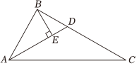
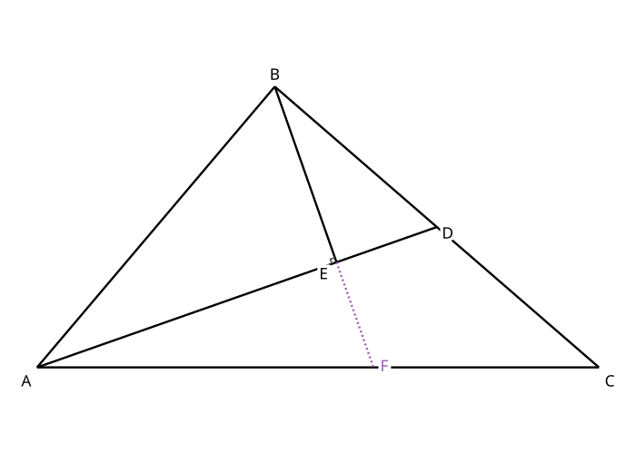

9. 如图，在 $\triangle ABC$ 中，$\angle ABC=3\angle C$，$AD$ 平分 $\angle BAC$ 交 $BC$ 于点 $D$，$BE\perp AD$ 于 $E$，求证：$BE=\frac{1}{2}(AC-AB)$。

> [!question]- 点击查看答案与解析
> 【答案】证明见解析，$BE=\dfrac12(AC-AB)$。
>
> 【考点】延长垂线构造三线合一、等腰三角形判定、角平分线 → [[【初中数学知识点体系-人教版】#15-3 等腰三角形]]、[[【初中数学知识点体系-人教版】#14-3 角的平分线]]
>
> 【解析】
> 延长 $BE$ 交 $AC$ 于 $F$。$\because AD\perp BF$，$AD$ 平分 $\angle BAF$，$\therefore \triangle ABF$ 为等腰三角形，$AB=AF$，且 $E$ 为 $BF$ 中点，$BE=\dfrac12 BF$。
> 由 $AB=AF$，得 $\angle ABF=\angle AFB$。又 $\angle AFB=\angle FBC+\angle C$，$\therefore \angle ABF=\angle FBC+\angle C$。
> $\because \angle ABC=\angle ABF+\angle FBC=3\angle C$，代入得 $(\angle FBC+\angle C)+\angle FBC=3\angle C$，$\therefore \angle FBC=\angle C$，$\therefore BF=FC$。
> $\therefore BE=\dfrac12 BF=\dfrac12 FC=\dfrac12(AC-AF)=\dfrac12(AC-AB)$。
> 
>
> 【易错点】关键是把 $BE$ 补成等腰三角形 $ABF$ 底边上的高，从而 $BE$ 是 $BF$ 的一半；再由角的倍半关系推出 $BF=FC$，最后用 $FC=AC-AB$ 代换。
