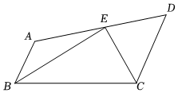
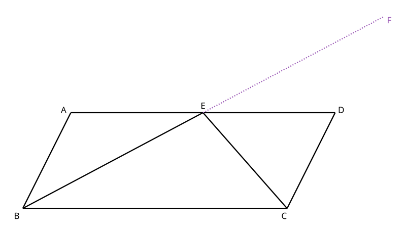

13. （2022秋•浠水县校级期中）如图所示，$AB\parallel CD$，$E$ 为 $AD$ 上一点，且 $BE$，$CE$ 分别平分 $\angle ABC$，$\angle BCD$。

（1）求证：$AE=DE$。

（2）已知 $AB=3$，$CD=5$，求 $BC$ 的长。

> [!question]- 点击查看答案与解析
> 【答案】$(1)$ 证明见解析；$(2)$ $BC=8$。
>
> 【考点】平行线性质、等腰三角形三线合一、全等三角形判定（AAS） → [[【初中数学知识点体系-人教版】#7-2 平行线]]、[[【初中数学知识点体系-人教版】#15-3 等腰三角形]]、[[【初中数学知识点体系-人教版】#14-2 三角形全等的判定]]
>
> 【解析】
> 延长 $BE$ 交 $CD$ 的延长线于 $F$。
> $\because AB\parallel CD$，$\therefore \angle ABE=\angle F$。又 $BE$ 平分 $\angle ABC$，$\therefore \angle ABE=\angle EBC$，$\therefore \angle EBC=\angle F$，$\therefore BC=CF$。
> 在等腰 $\triangle BCF$ 中，$CE$ 平分 $\angle BCF$，由三线合一得 $E$ 为 $BF$ 中点。
> 在 $\triangle ABE$ 与 $\triangle DFE$ 中：$\angle ABE=\angle F$，$BE=FE$，$\angle AEB=\angle DEF$，$\therefore \triangle ABE\cong\triangle DFE$（AAS），$\therefore AE=DE$，$AB=DF$。
>
> $(2)$ $CF=CD+DF=CD+AB=5+3=8$，$\therefore BC=CF=8$。
> 
>
> 【易错点】先由平行线 + 角平分线得到等腰 $\triangle BCF$，$CE$ 同时是中线；全等给出 $DF=AB$，因此 $BC=CD+AB$，不要把 $DF$ 漏掉。
