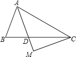
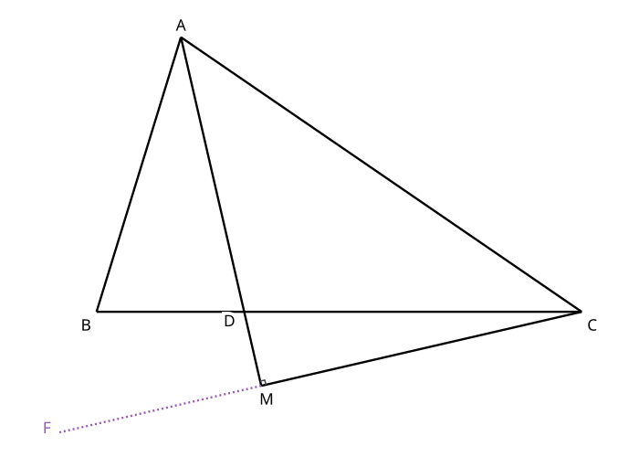

14. （2019秋•朝阳区校级期中）已知，如图，在 $\triangle ABC$ 中，$AD$ 平分 $\angle BAC$，$AD=AB$，$CM\perp AD$ 于 $M$，请你通过观察和测量，猜想线段 $AB$、$AC$ 之和与线段 $AM$ 有怎样的数量关系，并证明你的结论。猜想 $\angle B$，$\angle ACM$，$\angle BCM$ 有怎样的数量关系，并证明你的结论。

> [!question]- 点击查看答案与解析
> 【答案】$AB+AC=2AM$；$\angle B=\angle ACM+\angle BCM$。
>
> 【考点】角平分线对称构造等腰三角形、等腰三角形边角关系 → [[【初中数学知识点体系-人教版】#14-3 角的平分线]]、[[【初中数学知识点体系-人教版】#15-3 等腰三角形]]
>
> 【解析】
> 作点 $C$ 关于直线 $AD$ 的对称点 $F$，由 $AD$ 平分 $\angle BAC$，$F$ 落在射线 $AB$ 上，且 $AF=AC$；$CM\perp AD$，故 $M$ 为 $CF$ 中点。
> 结合 $AD=AB$，在等腰 $\triangle ABD$ 与等腰 $\triangle ACF$ 中进行边角代换，可得 $AB+AF=2AM$，代入 $AF=AC$，即 $AB+AC=2AM$。
>
> 角度关系：设 $\angle BAD=\angle DAC=\alpha$。在等腰 $\triangle ABD$ 中，$AB=AD$，$\therefore \angle B=\angle ADB=\dfrac{180^\circ-\alpha}{2}$。在 $\mathrm{Rt}\triangle AMC$ 中，$\angle ACM=90^\circ-\alpha$。由 $\angle ACB=180^\circ-2\alpha-\angle B$，可得 $\angle BCM=\angle ACM-\angle ACB=\dfrac{\alpha}{2}$，于是 $\angle ACM+\angle BCM=(90^\circ-\alpha)+\dfrac{\alpha}{2}=\angle B$。
> 
>
> 【易错点】对称点 $F$ 在 $AB$ 射线上，$AF=AC$；角度关系是 $\angle B$ 等于另外两个角之和，不要写成 $\angle B=\angle ACM-\angle BCM$。
