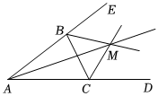

2. （2023秋•门头沟区期末）如图，在 $\triangle ABC$ 中，$AB<AC$，$\angle BAC$ 的平分线与外角 $\angle BCD$ 的平分线相交于点 $M$，作 $AB$ 的延长线得到射线 $AE$，再作射线 $BM$。下面有四个结论：

$①$ $\angle MCD>\angle MAB$；

$②$ 射线 $BM$ 是 $\angle EBC$ 的角平分线；

$③$ $BM=CM$；

$④$ $\angle BMC=90^\circ-\frac{1}{2}\angle BAC$。

其中所有正确结论的序号是 ___ 。

> [!question]- 点击查看答案与解析
> 【答案】$①$ $②$ $④$。
>
> 【考点】角平分线的判定、三角形外角性质、旁心角度关系 → [[【初中数学知识点体系-人教版】#14-3 角的平分线]]、[[【初中数学知识点体系-人教版】#13-3 三角形的内角与外角]]
>
> 【解析】
> $M$ 是 $\angle BAC$ 内角平分线与 $\angle BCD$ 外角平分线的交点，由三角形旁心性质，$M$ 也在 $\angle EBC$ 的外角平分线上。
>
> $①$ $\angle MCD=\dfrac12\angle BCD=\dfrac12(\angle BAC+\angle ABC)$，而 $\angle MAB=\dfrac12\angle BAC$，故 $\angle MCD>\angle MAB$，正确。
>
> $②$ 由旁心性质，$BM$ 平分 $\angle EBC$，正确。
>
> $③$ $BM=CM$ 一般不成立，只有当 $\angle MBC=\angle MCB$ 时才相等，题设无此条件，错误。
>
> $④$ 旁心 $M$ 对 $B$、$C$ 两点的张角 $\angle BMC=90^\circ-\dfrac12\angle BAC$，正确。
>
> 综上，正确结论为 $①$ $②$ $④$。
>
> 【易错点】旁心是两条外角平分线与一条内角平分线的交点；不要把旁心张角公式与内心公式 $\angle BIC=90^\circ+\dfrac12\angle A$ 混淆，旁心对应减号。
