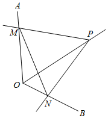
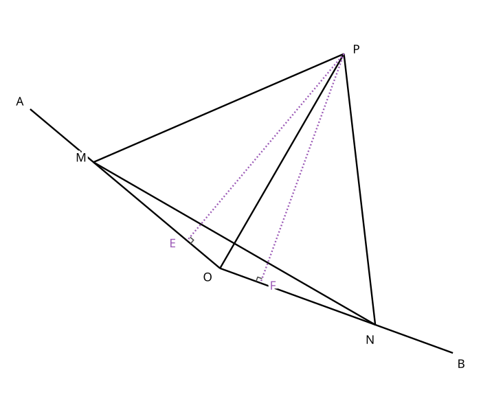

4. （2021•婺城区校级模拟）如图，点 $P$ 为定角 $\angle AOB$ 的平分线上的一个定点，且 $\angle MPN$ 与 $\angle AOB$ 互补，若 $\angle MPN$ 在绕点 $P$ 旋转的过程中，其两边分别与 $OA$、$OB$ 相交于 $M$、$N$ 两点，则以下结论：

（1）$PM=PN$ 恒成立；

（2）$OM-ON$ 的值不变；

（3）$\triangle OMN$ 的周长不变；

（4）四边形 $PMON$ 的面积不变，

其中正确的序号为 ___ 。

> [!question]- 点击查看答案与解析
> 【答案】$(1)(4)$。
>
> 【考点】角平分线的性质、全等三角形判定（ASA）、定值问题 → [[【初中数学知识点体系-人教版】#14-3 角的平分线]]、[[【初中数学知识点体系-人教版】#14-2 三角形全等的判定]]
>
> 【解析】
> 过 $P$ 作 $PE\perp OA$ 于 $E$，$PF\perp OB$ 于 $F$。$\because OP$ 平分 $\angle AOB$，$\therefore PE=PF$，且四边形 $OEPF$ 的形状大小固定。
> $\because \angle MPN+\angle AOB=180^\circ$，而四边形 $OEPF$ 中 $\angle EPF+\angle AOB=180^\circ$，$\therefore \angle MPN=\angle EPF$，于是 $\angle EPM=\angle FPN$。
> 在 $\triangle EPM$ 与 $\triangle FPN$ 中：$\angle PEM=\angle PFN=90^\circ$，$PE=PF$，$\angle EPM=\angle FPN$，$\therefore \triangle EPM\cong\triangle FPN$（ASA），$\therefore PM=PN$，$EM=FN$。故 $(1)$ 正确。
>
> $OM+ON=(OE+EM)+(OF-FN)=OE+OF$，为定值；但 $OM-ON=2EM$，$EM$ 随旋转变化，故 $(2)$ 错误。
> $\triangle OMN$ 的周长 $=OM+ON+MN$，$OM+ON$ 虽为定值，$MN$ 随旋转变化，故周长不是定值，$(3)$ 错误。
> 由全等得 $S_{\triangle EPM}=S_{\triangle FPN}$，$\therefore S_{\text{四边形}PMON}=S_{\text{四边形}OEPF}$，为定值，$(4)$ 正确。
> 
>
> 【易错点】定值要区分“和为定值”与“差为定值”：$OM+ON$ 不变不代表 $OM-ON$ 不变；周长不变还要求第三边 $MN$ 也不变。
