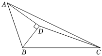
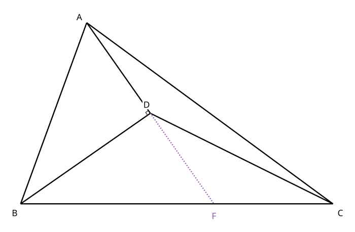

8. （2025秋•泸州校级期中）如图，在 $\triangle ABC$ 中，$BD$ 平分 $\angle ABC$，$AD\perp BD$，$\triangle BCD$ 的面积为 45，$\triangle ADC$ 的面积为 20，则 $\triangle ABD$ 的面积等于 ___ 。

> [!question]- 点击查看答案与解析
> 【答案】$S_{\triangle ABD}=25$。
>
> 【考点】等腰三角形三线合一、角平分线与高重合、三角形面积等分 → [[【初中数学知识点体系-人教版】#15-3 等腰三角形]]、[[【初中数学知识点体系-人教版】#14-3 角的平分线]]
>
> 【解析】
> 延长 $AD$ 交 $BC$ 于 $F$。$\because BD\perp AF$，且 $BD$ 平分 $\angle ABF$，$\therefore \triangle ABF$ 为等腰三角形，$D$ 为 $AF$ 的中点（三线合一）。
> $D$ 为 $AF$ 中点，$\therefore S_{\triangle CDF}=S_{\triangle CDA}=20$（共用从 $C$ 到 $AF$ 的高，$DF=DA$）。
> 又 $S_{\triangle BDF}=S_{\triangle BCD}-S_{\triangle CDF}=45-20=25$。
> 由 $D$ 为 $AF$ 中点，$S_{\triangle ABD}=S_{\triangle BDF}=25$。
> 
>
> 【易错点】辅助线是“延长 $AD$ 交 $BC$ 于 $F$”，补出等腰三角形 $ABF$；中点把三角形分成面积相等的两部分，不要把 $\triangle CDF$ 的面积当成 $\triangle BCD$ 的一半。
