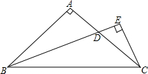
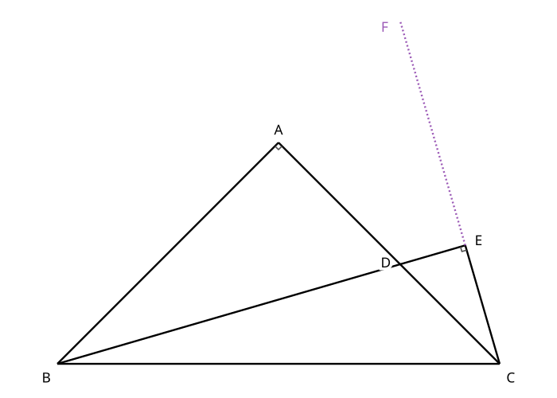

10. 如图，$\mathrm{Rt}\triangle ABC$ 中，$AB=AC$，$\angle A=90^\circ$，$\angle B$ 的平分线交 $AC$ 于 $D$，从 $C$ 点向 $BD$ 的延长线作垂线，垂足为 $E$。求证：$BD=2CE$。

> [!question]- 点击查看答案与解析
> 【答案】证明见解析，$BD=2CE$。
>
> 【考点】延长垂线构造等腰三角形、全等三角形判定（ASA）、等腰直角三角形 → [[【初中数学知识点体系-人教版】#14-2 三角形全等的判定]]、[[【初中数学知识点体系-人教版】#15-3 等腰三角形]]
>
> 【解析】
> 延长 $CE$ 交 $BA$ 的延长线于 $F$。$\because BE\perp CF$，$BE$ 平分 $\angle CBF$，$\therefore \triangle BCF$ 为等腰三角形，$BC=BF$，且 $E$ 为 $CF$ 中点，$CF=2CE$。
> $\because \angle BAD=\angle CAF=90^\circ$，$AB=AC$；又 $CF\perp BD$，$\therefore \angle ABD=90^\circ-\angle ADB=\angle ACF$。
> 在 $\triangle ABD$ 与 $\triangle ACF$ 中：$\angle ABD=\angle ACF$，$AB=AC$，$\angle BAD=\angle CAF$，$\therefore \triangle ABD\cong\triangle ACF$（ASA），$\therefore BD=CF$。
> 结合 $CF=2CE$，得 $BD=2CE$。
> 
>
> 【易错点】要证 $BD=2CE$，先把 $CE$ 补成整条线段 $CF$（$E$ 为中点），再用全等把 $CF$ 换成 $BD$；不要直接在 $CE$ 上找两倍关系。
