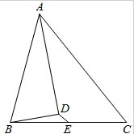
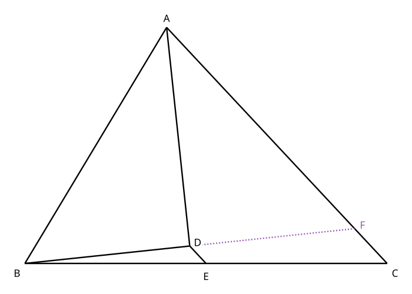

11. （2023春•砀山县期末）如图，$\triangle ABC$ 中，$AD$ 平分 $\angle BAC$，$AD\perp BD$，$E$ 为 $BC$ 的中点。

（1）求证：$DE\parallel AC$；

（2）若 $AB=4$，$AC=6$，求 $DE$ 的长。

> [!question]- 点击查看答案与解析
> 【答案】$(1)$ 证明见解析；$(2)$ $DE=1$。
>
> 【考点】三角形中位线定理、延长垂线构造等腰三角形、三线合一 → [[【初中数学知识点体系-人教版】#13-2 与三角形有关的线段]]、[[【初中数学知识点体系-人教版】#15-3 等腰三角形]]
>
> 【解析】
> 延长 $BD$ 交 $AC$ 于 $F$。$\because AD\perp BF$，$AD$ 平分 $\angle BAF$，$\therefore \triangle ABF$ 为等腰三角形，$AB=AF$，且 $D$ 为 $BF$ 中点。
>
> $(1)$ $\because E$ 为 $BC$ 中点，$D$ 为 $BF$ 中点，$\therefore DE$ 是 $\triangle BCF$ 的中位线，$\therefore DE\parallel CF$，即 $DE\parallel AC$。
>
> $(2)$ $AF=AB=4$，$\therefore FC=AC-AF=6-4=2$。由中位线定理，$DE=\dfrac12 FC=1$。
> 
>
> 【易错点】先补出等腰 $\triangle ABF$ 得到 $D$ 是 $BF$ 中点，$DE$ 才成为 $\triangle BCF$ 的中位线；$FC=AC-AB$，不要写成 $AC+AB$。
