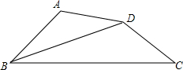
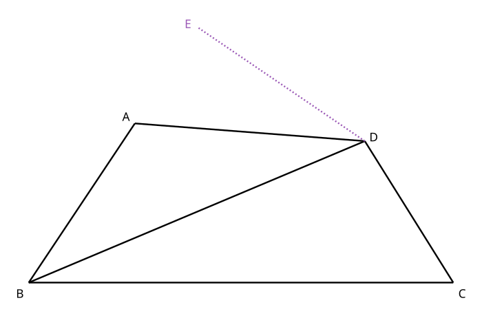

12. （2025秋•海淀区校级期中）如图，已知四边形 $ABCD$ 中，对角线 $BD$ 平分 $\angle ABC$，且 $\angle BAD$ 与 $\angle BCD$ 互补，求证：$AD=CD$。

> [!question]- 点击查看答案与解析
> 【答案】证明见解析，$AD=CD$。
>
> 【考点】角平分线截取等长构造全等、互补角转化、等腰三角形判定 → [[【初中数学知识点体系-人教版】#14-2 三角形全等的判定]]、[[【初中数学知识点体系-人教版】#15-3 等腰三角形]]
>
> 【解析】
> 在射线 $BA$ 上截取 $BE=BC$，连接 $DE$。
> 在 $\triangle BDE$ 与 $\triangle BDC$ 中：$BE=BC$，$\angle EBD=\angle CBD$，$BD=BD$，$\therefore \triangle BDE\cong\triangle BDC$（SAS），$\therefore DE=DC$，$\angle BED=\angle BCD$。
> $\because \angle BAD+\angle BCD=180^\circ$，又 $\angle BAD+\angle EAD=180^\circ$（邻补角），$\therefore \angle EAD=\angle BCD=\angle BED$，即 $\angle EAD=\angle AED$，$\therefore AD=DE$。
> 结合 $DE=DC$，得 $AD=CD$。
> 
>
> 【易错点】互补条件要通过邻补角转化为一组等角；截取点 $E$ 在射线 $BA$ 上，全等后 $DE$ 是连接 $AD$ 与 $CD$ 的中间等量。
