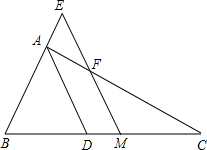
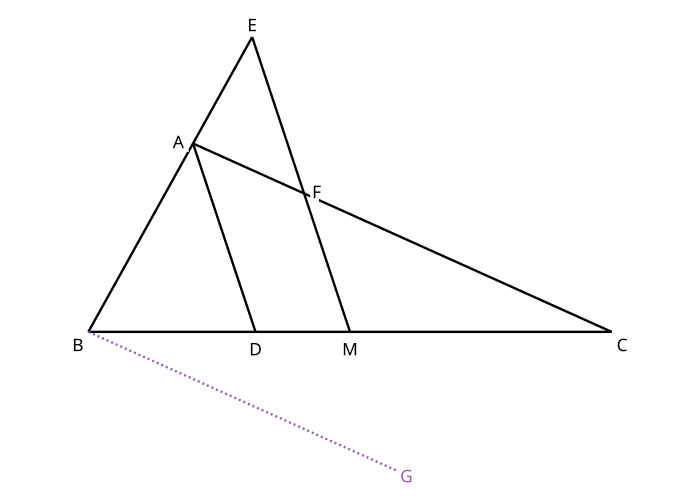

15. （2012秋•鄂城区校级月考）如图，$AD$ 为 $\triangle ABC$ 的角平分线，$M$ 为 $BC$ 的中点，$ME\parallel AD$ 交 $BA$ 的延长线于 $E$，交 $AC$ 于 $F$。求证：$BE=CF=\frac{1}{2}(AB+AC)$。

> [!question]- 点击查看答案与解析
> 【答案】证明见解析，$BE=CF=\dfrac12(AB+AC)$。
>
> 【考点】作平行线构造全等、角平分线平行出等腰、全等三角形判定 → [[【初中数学知识点体系-人教版】#14-2 三角形全等的判定]]、[[【初中数学知识点体系-人教版】#15-3 等腰三角形]]、[[【初中数学知识点体系-人教版】#7-2 平行线]]
>
> 【解析】
> 过 $B$ 作 $BG\parallel AC$，交 $FM$ 的延长线于 $G$。
> 在 $\triangle BMG$ 与 $\triangle CMF$ 中：$\angle MBG=\angle MCF$，$BM=CM$，$\angle BMG=\angle CMF$，$\therefore \triangle BMG\cong\triangle CMF$（ASA），$\therefore BG=CF$。
> $\because ME\parallel AD$，$AD$ 平分 $\angle BAC$，$\therefore \angle E=\angle BAD=\angle CAD=\angle AFE$，$\therefore AE=AF$。
> 又 $BG\parallel AC$，$\therefore \angle G=\angle CFG=\angle AFE=\angle E$，$\therefore BE=BG$。
> $\therefore BE=BG=CF$。
> 又 $BE=AB+AE$，$CF=AC-AF$，且 $AE=AF$，两式相加得 $BE+CF=AB+AC$，$\therefore BE=CF=\dfrac12(AB+AC)$。
> 
>
> 【易错点】辅助线是过 $B$ 作 $AC$ 的平行线构造全等；$BE=AB+AE$ 而 $CF=AC-AF$，利用 $AE=AF$ 抵消后再取半，不要直接把 $BE$、$CF$ 与 $AB$、$AC$ 列错加减号。
