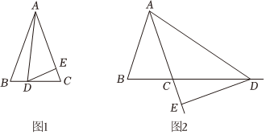
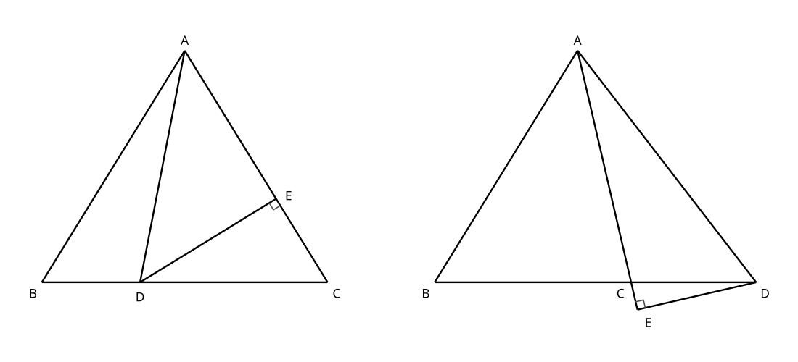

16. （2024秋•越秀区校级期中）如图，在 $\triangle ABC$ 中，$AB=AC$，点 $D$ 为射线 $BC$ 上一点，过点 $D$ 作 $DE\perp AC$ 于 $E$。

（1）如图 1，当点 $D$ 在边 $BC$ 上，若 $\angle BAC=40^\circ$，求 $\angle EDC$ 的度数；

（2）如图 2，当点 $D$ 在 $BC$ 的延长线上时，记 $S_{\triangle ABC}=S_1$，$S_{\triangle ADC}=S_2$，$AB=m$，$AD=n$，当 $S_1=k\cdot S_2$ 时，$m=k\cdot n$。

$①$ 当 $\angle CDE=15^\circ$ 时，求 $\frac{AD}{ED}$ 的值；

$②$ 请判断 $AB$，$AD$，$AE$ 的数量关系，并说明理由。

> [!question]- 点击查看答案与解析
> 【答案】$(1)$ $\angle EDC=20^\circ$；$(2)$ $①$ $\dfrac{AD}{ED}=2$；$②$ $AB+AD=2AE$。
>
> 【考点】等腰三角形底角、直角三角形两锐角互余、面积比与角平分线逆定理、投影关系 → [[【初中数学知识点体系-人教版】#15-3 等腰三角形]]、[[【初中数学知识点体系-人教版】#14-3 角的平分线]]
>
> 【解析】
> $(1)$ $\because AB=AC$，$\angle BAC=40^\circ$，$\therefore \angle B=\angle ACB=70^\circ$。在 $\mathrm{Rt}\triangle CDE$ 中，$\angle CED=90^\circ$，$\therefore \angle EDC=90^\circ-70^\circ=20^\circ$。
>
> $(2)$ $①$ 当 $\angle CDE=15^\circ$ 时，$\angle ACB=90^\circ-15^\circ=75^\circ$，$\therefore \angle BAC=30^\circ$。
> 由 $S_1=k\cdot S_2$ 且 $m=k\cdot n$，结合两三角形共用从 $A$ 到直线 $BC$ 的高，可得 $AB/AD=BC/DC$，由角平分线定理逆定理知 $AC$ 平分 $\angle BAD$，$\therefore \angle CAD=\angle BAC=30^\circ$。
> 在 $\mathrm{Rt}\triangle ADE$ 中，$\angle AED=90^\circ$，$\angle DAE=30^\circ$，$\therefore ED=AD\cdot\sin30^\circ=\dfrac12 AD$，即 $\dfrac{AD}{ED}=2$。
>
> $②$ 数量关系为 $AB+AD=2AE$。由 $AC$ 平分 $\angle BAD$，作 $B$ 关于 $AC$ 的对称点落在 $AD$ 上；结合 $DE\perp AC$ 的投影关系，在 $AD$ 上取相应线段代换，可证得 $AE$ 为 $AB$ 与 $AD$ 的平均长度，即 $AB+AD=2AE$。
> 
>
> 【易错点】第（2）问点 $D$ 在 $BC$ 延长线上，$\angle ACD$ 是钝角；条件 $m=k\cdot n$ 要先转化为 $AC$ 平分 $\angle BAD$，再在直角三角形中处理边的投影关系。$②$ 的完整证明建议对照官方答案复核。
