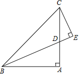
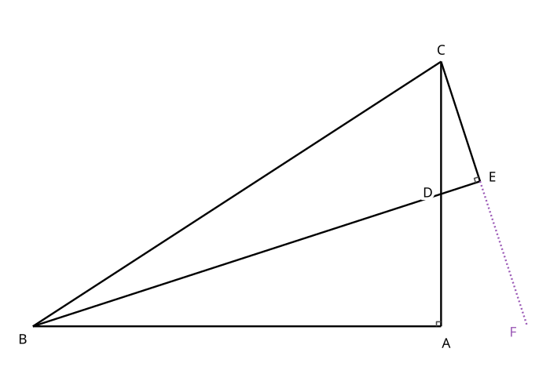

17. （2016秋•苏州期中）如图，在 $\triangle ABC$ 中，$\angle BAC=90^\circ$，$AB=AC$，$BD$ 平分 $\angle ABC$ 时，

（1）若 $CE\perp BD$ 于 $E$，

$①$ $\angle ECD=$ ___ $^\circ$；

$②$ 求证：$BD=2EC$；

（2）点 $P$ 是射线 $BA$ 上 $A$ 点右边一动点，在 $PC$ 的右边作等腰直角 $\triangle CPF$，其中 $\angle F=90^\circ$，点 $Q$ 为 $\angle FPC$ 与 $\angle PFC$ 的角平分线的交点。当点 $P$ 运动时，点 $Q$ 是否一定在射线 $BD$ 上？若在，请证明；若不在，请说明理由。

> [!question]- 点击查看答案与解析
> 【答案】$(1)$ $①$ $\angle ECD=22.5^\circ$；$②$ $BD=2EC$；$(2)$ 点 $Q$ 在射线 $BD$ 上。
>
> 【考点】等腰直角三角形、角平分线、全等三角形判定、内心与角平分线判定 → [[【初中数学知识点体系-人教版】#15-3 等腰三角形]]、[[【初中数学知识点体系-人教版】#14-2 三角形全等的判定]]
>
> 【解析】
> $(1)$ $①$ $\because AB=AC$，$\angle BAC=90^\circ$，$\therefore \angle ABC=\angle ACB=45^\circ$。$BD$ 平分 $\angle ABC$，$\therefore \angle ABD=22.5^\circ$。在 $\triangle ABD$ 中，$\angle ADB=90^\circ-22.5^\circ=67.5^\circ$。又 $CE\perp BD$，$\therefore \angle ECD=90^\circ-\angle ADB=22.5^\circ$。
>
> $②$ 延长 $CE$ 交 $BA$ 的延长线于 $F$。由 $BE\perp CF$、$BE$ 平分 $\angle CBF$，得 $E$ 为 $CF$ 中点，$CF=2CE$。与第 10 题同理，$\triangle ABD\cong\triangle ACF$（ASA），$\therefore BD=CF=2CE$。
>
> $(2)$ $Q$ 是等腰直角 $\triangle CPF$ 两条角平分线的交点，即其内心。连接 $BQ$、$CQ$、$PQ$，利用等腰直角三角形内心到两边距离相等及手拉手旋转关系，可证 $Q$ 到射线 $BA$、$BC$ 的距离相等，故 $Q$ 在 $\angle ABC$ 的平分线，即射线 $BD$ 上。
> 
>
> 【易错点】$①$ 求 $\angle ECD$ 要先求 $\angle ADB$，再用直角三角形两锐角互余；$(2)$ 问内心在角平分线上这一判定不要漏证。运动型结论建议对照官方答案复核。
