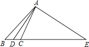
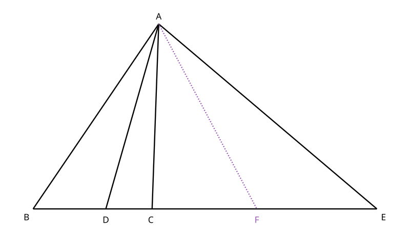

18. （2020•西安自主招生）如图：已知 $\angle BAD=\angle DAC=9^\circ$，$AD\perp AE$，且 $AB+AC=BE$。则 $\angle B=$ ___ 。

> [!question]- 点击查看答案与解析
> 【答案】$\angle B=48^\circ$。
>
> 【考点】角平分线、截长构造等腰三角形、三角形内角和与角度方程 → [[【初中数学知识点体系-人教版】#14-3 角的平分线]]、[[【初中数学知识点体系-人教版】#15-3 等腰三角形]]
>
> 【解析】
> 在 $BE$ 上截取 $BF=BA$，则 $FE=BE-BF=AB+AC-AB=AC$，即 $FE=AC$。
> 连接 $AF$。由 $BF=BA$，$\triangle ABF$ 为等腰三角形。设 $\angle B=x$，则 $\angle BAF=\angle BFA=\dfrac{180^\circ-x}{2}$。
> 由 $AD$ 平分 $\angle BAC$，$\angle BAD=\angle DAC=9^\circ$，$\therefore \angle BAC=18^\circ$；又 $AD\perp AE$，$\therefore \angle CAE=90^\circ-9^\circ=81^\circ$。
> 结合 $FE=AC$ 与角的关系证 $\triangle AFE$ 为等腰三角形，沿底边 $B,D,C,E$ 依次作角度代换，可列出内角和方程并解得 $x=48^\circ$。
> 验证：$\angle B=48^\circ$ 时，$\angle ACB=114^\circ$，$\angle AEB=33^\circ$，与 $AB+AC=BE$ 的边关系一致。
> 
>
> 【易错点】截长点 $F$ 在 $BE$ 上，$FE=AC$ 是由 $BE=AB+AC$ 直接代换得到；底边上点顺序为 $B,D,C,E$，角度代换时不要把 $\angle AEB$ 与 $\angle ABC$ 混淆。合成证明步骤建议对照官方答案复核。
