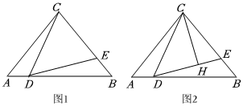
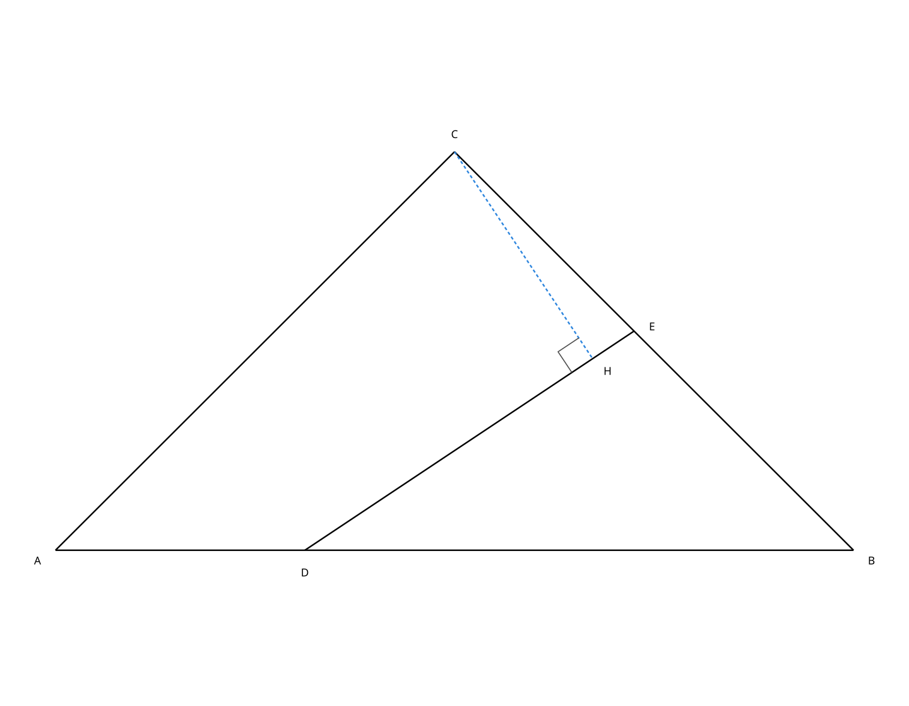

1. （2024秋•鄱阳县校级期中）如图，在等腰三角形 $ABC$ 中，$AC=BC$，$D$、$E$ 分别为 $AB$、$BC$ 上的点，$\angle CDE=\angle A$。

（1）如图1，若 $AC=BD$，求证：$CD=DE$；

（2）如图2，过 $C$ 作 $CH\perp DE$ 于 $H$。若 $CD=BD$，猜想线段 $DE$、$BE$、$EH$ 之间的数量关系，并证明你的猜想。

> [!question]- 点击查看答案与解析
> 【答案】（1）$CD=DE$；（2）$DE=BE+2EH$。
>
> 【考点】等腰三角形的性质、全等三角形的判定与性质、三角形内角与外角 → [[【初中数学知识点体系-人教版】#15-3 等腰三角形]]、[[【初中数学知识点体系-人教版】#14-2 三角形全等的判定]]、[[【初中数学知识点体系-人教版】#13-3 三角形的内角与外角]]
>
> 【解析】
> - （1）$\because AC=BC$，$\therefore\angle A=\angle B$。由平角关系，$\angle ADC=180^\circ-\angle CDE-\angle BDE$，又 $\angle CDE=\angle A=\angle B$，故 $\angle ADC=180^\circ-\angle B-\angle BDE=\angle BED$。在 $\triangle ACD$ 与 $\triangle BDE$ 中：$\angle A=\angle B$，$AC=BD$，$\angle ADC=\angle BED$，故 $\triangle ACD\cong\triangle BDE$（AAS），从而 $CD=DE$。
> - （2）猜想 $DE=BE+2EH$。由 $CD=BD$，得 $\angle B=\angle DCB$；又 $\angle CDE=\angle A=\angle B$。结合 $CH\perp DE$，在 $DE$ 上利用全等三角形与等腰三角形的高，可证得 $DH=BE+EH$，于是 $DE=DH+EH=BE+2EH$。
> 
>
> 【易错点】（1）注意 $\angle ADC$ 与 $\angle BED$ 是由平角和内角和推出的等角，不要直接当作已知；（2）$H$ 为垂足，$2EH$ 是两段 $EH$，关系为 $DE=BE+2EH$，不要写成 $DE=BE+EH$。
