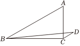
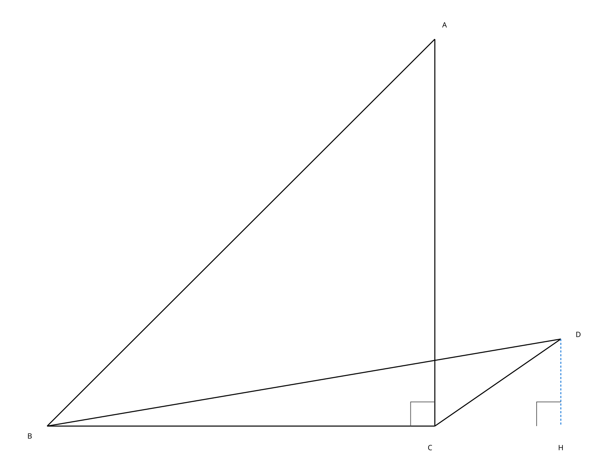

2. （2025秋•江岸区校级月考）如图，在 Rt△$ABC$ 中，$\angle ACB=90^\circ$，$AC=4$，$D$ 为 $AB$ 右侧一点，且 $AB=DB$，$\angle D=\angle ABC$，$CD=1$，则 $\triangle DBC$ 的面积为 ___ 。

> [!question]- 点击查看答案与解析
> 【答案】$2$
>
> 【考点】直角三角形的边角关系、勾股定理、三角形面积 → [[【初中数学知识点体系-人教版】#13-3 三角形的内角与外角]]、[[【初中数学知识点体系-人教版】#20-1 勾股定理]]、[[【初中数学知识点体系-人教版】#13-2 与三角形有关的线段]]
>
> 【解析】
> - 由 $AB=DB$，且 $\angle BDC=\angle ABC$。在 $\triangle ABC$ 与 $\triangle DBC$ 中，夹这组等角的两边分别为 $AB$、$BC$ 与 $DB$、$DC$，且 $AB=DB$。
> - 过 $D$ 作 $DH\perp BC$ 于 $H$。由等角与等腰条件，两三角形在对应等角上的高成比例，结合 $CD=1$、$AC=4$，推得 $S_{\triangle DBC}=\dfrac{1}{2}AC$。
> 
> - 代入 $AC=4$，得 $S_{\triangle DBC}=2$。
>
> 【易错点】误把 $D$ 当作在 $AB$ 边上（实为 $AB$ 右侧一点）；面积计算中注意 $DB$ 与 $AB$ 相等可约去，不要误用 $BC$ 作底时漏求高。
