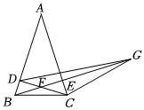
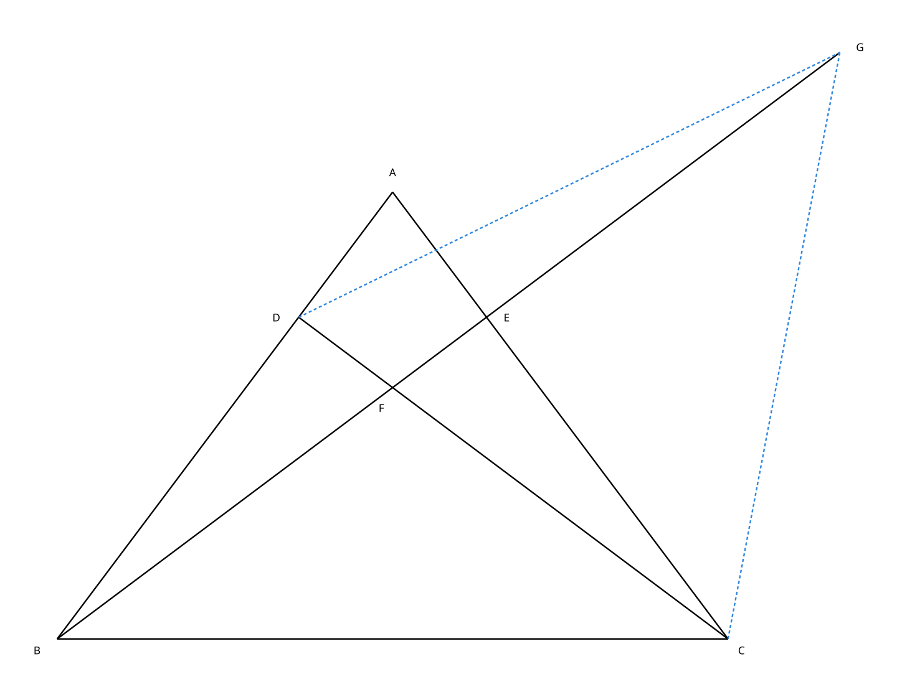

3. （2023秋•武昌区校级期中）如图，$AB=AC$，$\triangle ABC$ 的两条高 $CD$、$BE$ 交于点 $F$。

（1）证明：$CD=BE$；

（2）若延长 $BE$ 至点 $G$，使 $FG=AC$，连接 $DG$、$CG$，$BE=6$，求 $\triangle CDG$ 的面积。

> [!question]- 点击查看答案与解析
> 【答案】（1）$CD=BE$；（2）$S_{\triangle CDG}=18$。
>
> 【考点】等腰三角形的性质、三角形的高、全等三角形的判定与性质、三角形面积 → [[【初中数学知识点体系-人教版】#15-3 等腰三角形]]、[[【初中数学知识点体系-人教版】#13-2 与三角形有关的线段]]、[[【初中数学知识点体系-人教版】#14-1 全等三角形及其性质]]
>
> 【解析】
> - （1）$\because CD$、$BE$ 为高，$\therefore\angle ADC=\angle AEB=90^\circ$。在 $\triangle ABE$ 与 $\triangle ACD$ 中：$\angle AEB=\angle ADC$，$\angle A$ 公共，$AB=AC$，故 $\triangle ABE\cong\triangle ACD$（AAS），从而 $BE=CD$。
> - （2）由（1）$CD=BE=6$。结合垂心 $F$ 的角度关系及 $FG=AC=AB$，可证相关线段与角对应相等，得 $\triangle CDG$ 的面积 $S_{\triangle CDG}=\dfrac{1}{2}\,BE^{2}$。代入 $BE=6$，得 $S_{\triangle CDG}=\dfrac{1}{2}\times 6^{2}=18$。
> 
>
> 【易错点】$F$ 是两条高的交点（垂心），$G$ 在 $BE$ 的延长线上；面积结论由 $CD$、$BE$ 的等量关系推出，不要误用底乘高时把 $FG$ 当作高。
