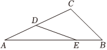
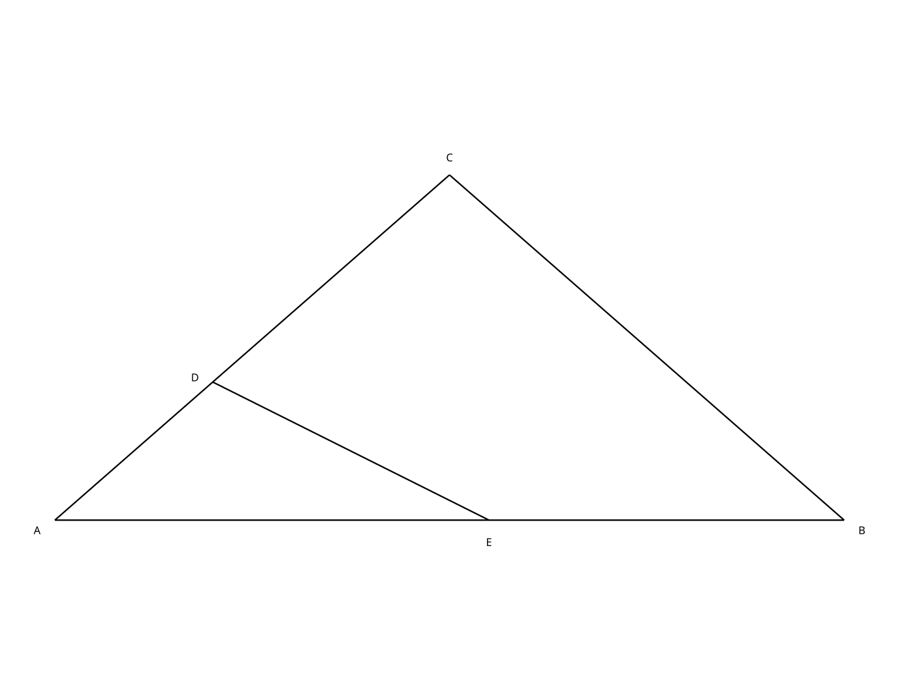

4. 如图，在 $\triangle ABC$ 中，点 $D$ 在 $AC$ 上，点 $E$ 在 $AB$ 上，$\angle CDE=\angle B$，$DE=BC$，求证：$AC=AE$。

> [!question]- 点击查看答案与解析
> 【答案】$AC=AE$，证明见解析。
>
> 【考点】全等三角形的判定与性质、三角形内角和 → [[【初中数学知识点体系-人教版】#14-2 三角形全等的判定]]、[[【初中数学知识点体系-人教版】#13-3 三角形的内角与外角]]
>
> 【解析】
> - 由 $A$、$D$、$C$ 共线，$\angle ADE=180^\circ-\angle CDE=180^\circ-\angle B$。
> 
> - 在 $\triangle ADE$ 中，$\angle AED=180^\circ-\angle A-\angle ADE=\angle B-\angle A$；结合 $\triangle ABC$ 的内角关系，两组对应角分别与 $\triangle ABC$ 的角对应相等，且已知 $DE=BC$。
> - 沿 $D$（或 $E$）截取辅助线段构造全等三角形，使 $DE$ 与 $BC$ 为对应边、$\angle CDE$ 与 $\angle B$ 为对应角，得另一组对应边相等，从而 $AC=AE$。
>
> 【易错点】$D$ 在 $AC$ 上、$E$ 在 $AB$ 上，注意 $\angle CDE$ 与 $\angle ADE$ 互为邻补角，相等关系不要混用；$DE$ 与 $BC$ 是全等对应边，对应顶点不要配错。
