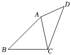
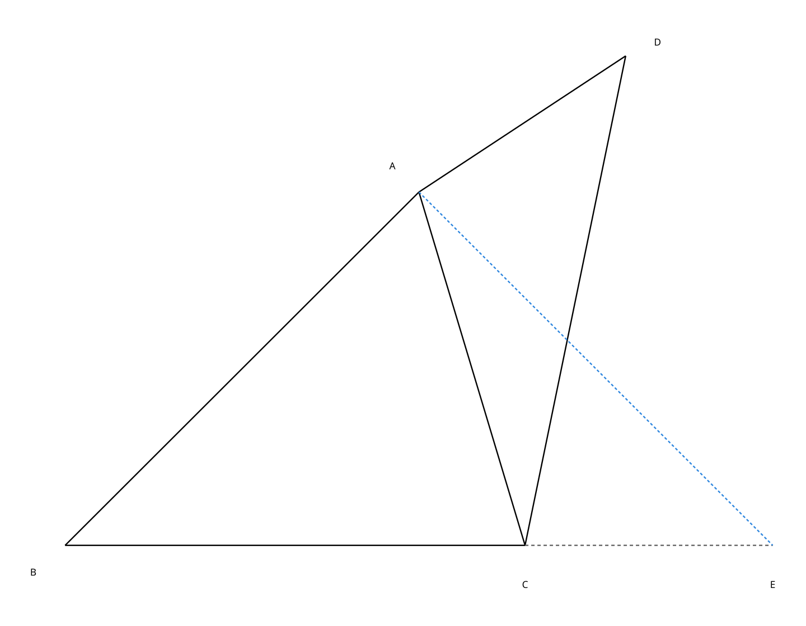

5. 如图，在四边形 $ABCD$ 中，$AB=CD$，$\angle DAC+\angle BCA=180^\circ$，$\angle B+\angle D=90^\circ$，且四边形 $ABCD$ 的面积是 $18$，则 $CD$ 的长为 ___ 。

> [!question]- 点击查看答案与解析
> 【答案】$CD=6$
>
> 【考点】全等三角形的判定与构造、四边形内角和、三角形面积 → [[【初中数学知识点体系-人教版】#14-2 三角形全等的判定]]、[[【初中数学知识点体系-人教版】#13-3 三角形的内角与外角]]、[[【初中数学知识点体系-人教版】#13-2 与三角形有关的线段]]
>
> 【解析】
> - 延长 $BC$ 至点 $E$，使 $CE=AD$，连接 $AE$。由 $\angle DAC+\angle BCA=180^\circ$，又 $\angle ECA+\angle BCA=180^\circ$，得 $\angle DAC=\angle ECA$。
> 
> - 在 $\triangle DAC$ 与 $\triangle ECA$ 中：$AD=CE$，$\angle DAC=\angle ECA$，$AC=CA$，故 $\triangle DAC\cong\triangle ECA$（SAS），从而 $CD=AE$，$\angle ACD=\angle CAE$。
> - 由四边形内角和 $360^\circ$，$\angle B+\angle D+\angle BAC+\angle CAD+\angle BCA+\angle ACD=360^\circ$；代入 $\angle CAD+\angle BCA=180^\circ$、$\angle B+\angle D=90^\circ$，得 $\angle BAC+\angle ACD=90^\circ$，于是 $\angle BAE=\angle BAC+\angle CAE=\angle BAC+\angle ACD=90^\circ$。
> - 又 $AB=CD=AE$，故 $S_{ABCD}=S_{\triangle ABC}+S_{\triangle ACD}=S_{\triangle ABC}+S_{\triangle ECA}=S_{\triangle ABE}=\dfrac{1}{2}\,AB\cdot AE=\dfrac{1}{2}\,CD^{2}=18$，$CD^{2}=36$，故 $CD=6$。
>
> 【易错点】辅助线是延长 $BC$ 到 $E$ 使 $CE=AD$（不是延长 $DA$）；$\angle B+\angle D=90^\circ$ 需经四边形内角和转化为 $\angle BAC+\angle ACD=90^\circ$，不要直接当作直角条件；结果取算术平方根，舍去负值。
