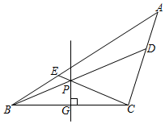
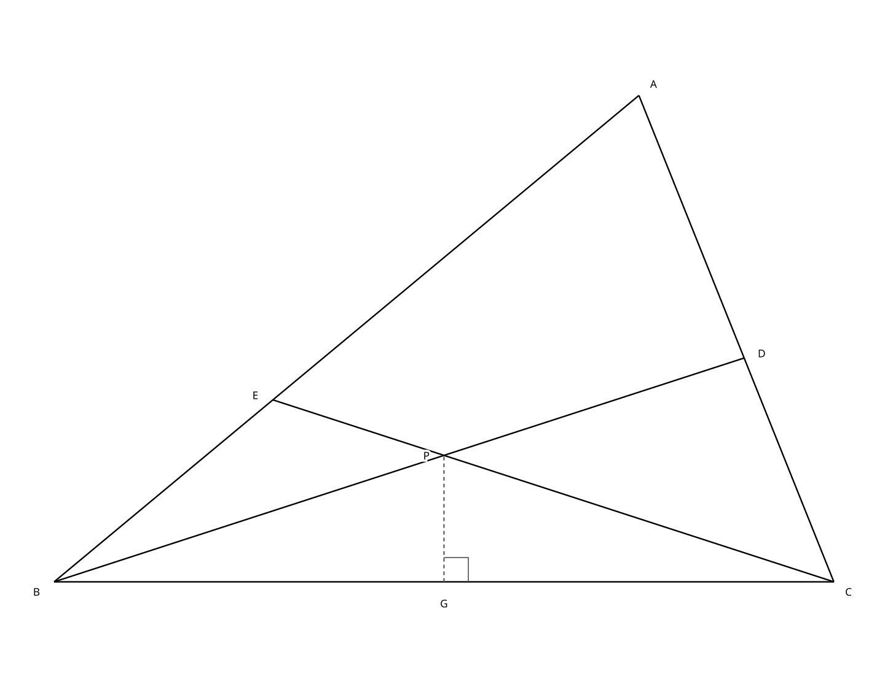

6. 如图，直线 $PG$ 为 $\triangle ABC$ 的边 $BC$ 的垂直平分线，$\angle PBC=\frac{1}{2}\angle A$，$BP$，$CP$ 的延长线分别交 $AC$，$AB$ 于点 $D$，$E$。试说明：$BE=CD$。

> [!question]- 点击查看答案与解析
> 【答案】$BE=CD$，证明见解析。
>
> 【考点】线段垂直平分线的性质、全等三角形的判定与性质、轴对称 → [[【初中数学知识点体系-人教版】#13-2 与三角形有关的线段]]、[[【初中数学知识点体系-人教版】#14-2 三角形全等的判定]]、[[【初中数学知识点体系-人教版】#15-1 图形的轴对称]]
>
> 【解析】
> - $\because PG$ 是 $BC$ 的垂直平分线，$\therefore PB=PC$，$\angle PBC=\angle PCB$。
> - 由 $\angle PBC=\dfrac{1}{2}\angle A$，得 $\angle PCB=\dfrac{1}{2}\angle A$。结合三角形内角和，可推得 $\angle PBE=\angle PCD$（即 $AB$、$AC$ 与 $PB$、$PC$ 所夹的两组角相等）。
> - 又 $\angle BPE=\angle CPD$（对顶角相等）。在 $\triangle PBE$ 与 $\triangle PCD$ 中：$PB=PC$，$\angle PBE=\angle PCD$，$\angle BPE=\angle CPD$，故 $\triangle PBE\cong\triangle PCD$（ASA），从而 $BE=CD$。
> 
>
> 【易错点】$BP$ 延长线交 $AC$ 于 $D$、$CP$ 延长线交 $AB$ 于 $E$，注意 $E$ 在 $AB$ 上、$D$ 在 $AC$ 上，全等对应边 $BE$ 对应 $CD$，不要与 $PE$、$PD$ 混淆。
