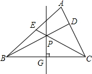
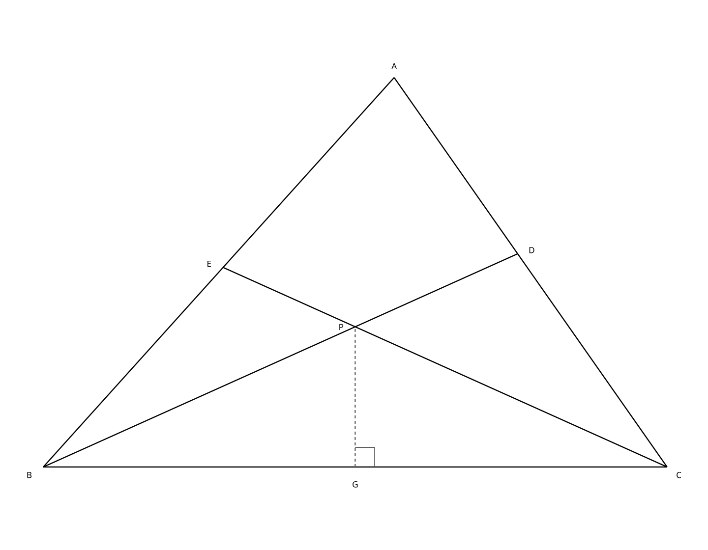

7. （2012•麻城市校级模拟）如图，$P$ 为 $\triangle ABC$ 的边 $BC$ 的垂直平分线上的一点，此垂直平分线交 $BC$ 于 $G$，且 $\angle PCB=\frac{1}{2}\angle A$，$BP$、$CP$ 的延长线分别交 $AC$、$AB$ 于 $D$、$E$。求证：$BE=CD$。

> [!question]- 点击查看答案与解析
> 【答案】$BE=CD$，证明见解析。
>
> 【考点】线段垂直平分线的性质、全等三角形的判定与性质、轴对称 → [[【初中数学知识点体系-人教版】#13-2 与三角形有关的线段]]、[[【初中数学知识点体系-人教版】#14-2 三角形全等的判定]]、[[【初中数学知识点体系-人教版】#15-1 图形的轴对称]]
>
> 【解析】
> - $\because P$ 在 $BC$ 的垂直平分线上，$\therefore PB=PC$，$\angle PBC=\angle PCB$。
> - 由 $\angle PCB=\dfrac{1}{2}\angle A$，得 $\angle PBC=\dfrac{1}{2}\angle A$。结合三角形内角和，推得 $\angle PBE=\angle PCD$。
> - 又 $\angle BPE=\angle CPD$（对顶角相等）。在 $\triangle PBE$ 与 $\triangle PCD$ 中：$PB=PC$，$\angle PBE=\angle PCD$，$\angle BPE=\angle CPD$，故 $\triangle PBE\cong\triangle PCD$（ASA），从而 $BE=CD$。
> 
>
> 【易错点】本题半角条件在 $\angle PCB$（与第 6 题的 $\angle PBC$ 对称），推导等角时注意方向；$BE$ 对应 $CD$，不要与 $PE$、$PD$ 混淆。
