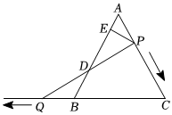
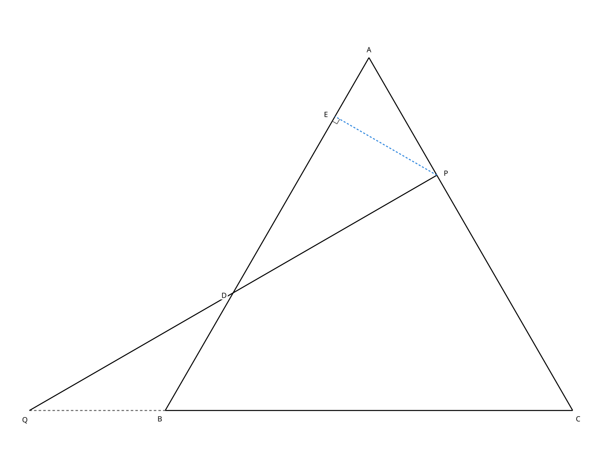

8. （2022秋•腾冲市期末）$\triangle ABC$ 是边长为 $9$ 的等边三角形，$P$ 是 $AC$ 边上一动点，由 $A$ 向 $C$ 运动（点 $A$、$C$ 不重合），$Q$ 是 $CB$ 延长线上一动点，与点 $P$ 同时以相同的速度由 $B$ 向 $CB$ 延长线方向运动（$Q$ 不与 $B$ 重合），过 $P$ 作 $PE\perp AB$ 于 $E$，连接 $PQ$ 交 $AB$ 于 $D$。

（1）如图，当 $PQ\perp AC$ 时，求 $AP$ 的长；

（2）在运动过程中线段 $DE$ 的长是否发生变化？如果不变，求出线段 $DE$ 的长；如果变化，请说明理由。

> [!question]- 点击查看答案与解析
> 【答案】（1）$AP=\dfrac{3}{2}$；（2）$DE$ 不变，$DE=\dfrac{9}{2}$。
>
> 【考点】等边三角形的性质、全等三角形的判定与性质、三角形中的线段（垂线） → [[【初中数学知识点体系-人教版】#15-3 等腰三角形]]、[[【初中数学知识点体系-人教版】#14-2 三角形全等的判定]]、[[【初中数学知识点体系-人教版】#13-2 与三角形有关的线段]]
>
> 【解析】
> - 设 $AP=BQ=t$。$\triangle ABC$ 为等边三角形，$\angle A=\angle ABC=\angle C=60^\circ$。
> - 由 $PE\perp AB$，在 Rt$\triangle APE$ 中 $\angle A=60^\circ$，得 $AE=\dfrac{1}{2}AP=\dfrac{t}{2}$。
> - （1）当 $PQ\perp AC$ 时，结合 $\angle C=60^\circ$ 与 $P$、$Q$ 同速（$AP=BQ$），由直角三角形的边角关系推得 $t=\dfrac{3}{2}$，即 $AP=\dfrac{3}{2}$。
> - （2）设 $PQ$ 与 $AB$ 交于 $D$。由等边三角形的 $60^\circ$ 角及 $AP=BQ$ 的等量关系，$D$ 在 $AB$ 上的位置满足 $AD-AE=DE=\dfrac{9}{2}$，该结果与动点 $P$ 的位置 $t$ 无关，故运动过程中 $DE$ 为定值 $\dfrac{9}{2}$，不发生变化。
> 
>
> 【易错点】误认为动点运动中 $DE$ 随 $AP$ 变化；注意 $Q$ 在 $CB$ 的延长线上（过 $B$ 背离 $C$ 一侧），方向不要取反。
