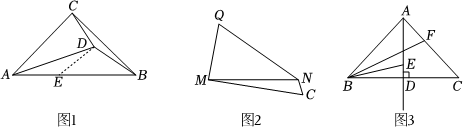
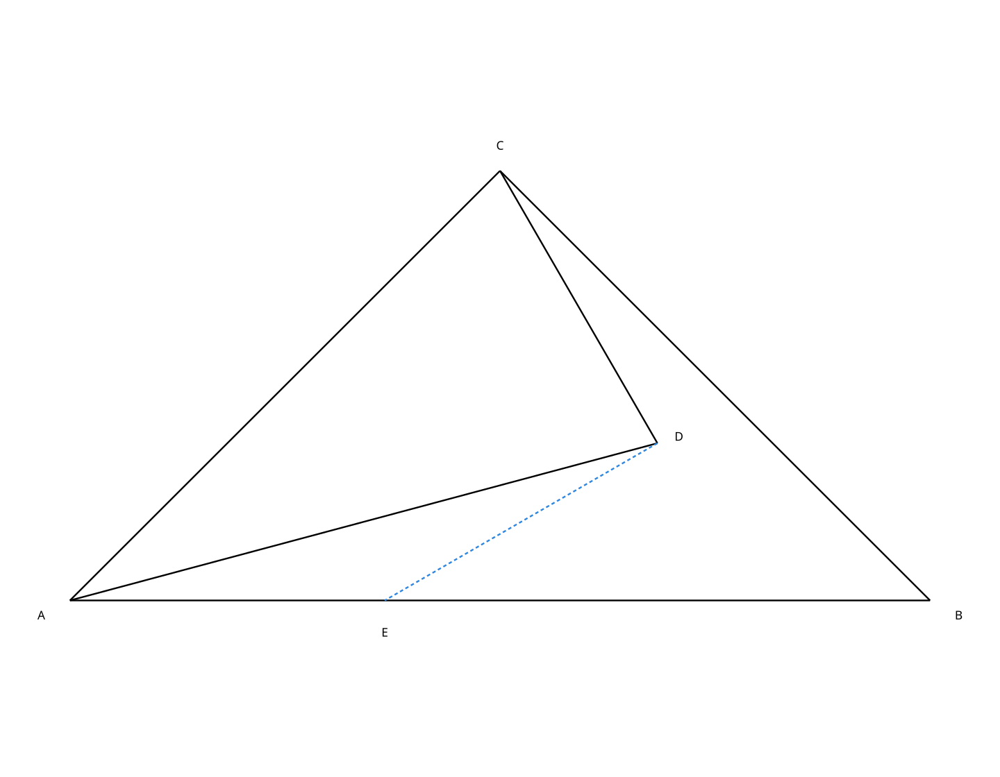

9. （2026春•法库县期中）

（1）如图1，已知等腰直角三角形中，$AC=BC$，在三角形内取一点 $D$，使得 $AD=AC$，$\angle CAD=30^\circ$，求 $\angle ADB$ 的度数；

小亮通过挖掘已知条件，获得 $\angle DAB=\angle DCB=15^\circ$，线段 $BC=AD$，这样本题就具备了一边一角的图形特征，所以小明果断地在 $AB$ 上截取 $AE=CD$，构造出全等三角形，从而使问题得以解决．请按照小亮的思路完整解答；

（2）如图2，在四边形 $MCNQ$ 中，$\angle MNC+\angle QMN=180^\circ$，$\angle C=\angle Q$，求证：$MC=NQ$；小亮深入研究已知条件，迅速想到：延长 $QM$ 到点 $G$，使得 $MG=NC$，连接 $GN$，从而使问题得以解决．请按照小亮的思路完整解答；

（3）如图3，在 $\triangle ABC$ 中，$\angle BAC=90^\circ$，$AB=AC=2$，射线 $AD\perp BC$ 于点 $D$。若点 $E$，$F$ 分别是射线 $AD$，边 $AC$ 上的动点，$AE=CF$，连接 $BE$，$BF$，直接写出 $BE+BF$ 最小值。

> [!question]- 点击查看答案与解析
> 【答案】（1）$\angle ADB=135^\circ$；（2）$MC=NQ$；（3）$BE+BF$ 的最小值为 $2\sqrt{3}$。
>
> 【考点】等腰直角三角形的性质、全等三角形的判定与性质、平行四边形的判定、勾股定理与最短路径 → [[【初中数学知识点体系-人教版】#15-3 等腰三角形]]、[[【初中数学知识点体系-人教版】#14-2 三角形全等的判定]]、[[【初中数学知识点体系-人教版】#21-1 平行四边形]]、[[【初中数学知识点体系-人教版】#20-1 勾股定理]]
>
> 【解析】
> - （1）$\because AC=BC$，$\angle ACB=90^\circ$，$\therefore\angle CAB=\angle CBA=45^\circ$。由 $AD=AC=BC$，$\angle CAD=30^\circ$，得等腰 $\triangle ACD$ 中 $\angle ACD=\angle ADC=75^\circ$，故 $\angle DAB=45^\circ-30^\circ=15^\circ$，$\angle DCB=90^\circ-75^\circ=15^\circ$。在 $AB$ 上截取 $AE=CD$，连接 $DE$。在 $\triangle ADE$ 与 $\triangle BCD$ 中：$AD=BC$，$\angle DAE=\angle BCD=15^\circ$，$AE=CD$，故 $\triangle ADE\cong\triangle BCD$（SAS），得 $DE=DB$、$\angle ADE=\angle CBD$，进而推得 $\angle ADB=135^\circ$。
> 
> - （2）由 $\angle MNC+\angle QMN=180^\circ$，得 $MQ\parallel NC$。延长 $QM$ 至 $G$，使 $MG=NC$，连接 $GN$。由 $MG\parallel NC$ 且 $MG=NC$，得四边形 $MCNG$ 为平行四边形，故 $MC=GN$，$\angle C=\angle MGN$。又 $\angle C=\angle Q$，故 $\angle MGN=\angle Q$，$\triangle QGN$ 为等腰三角形，$GN=NQ$，从而 $MC=NQ$。
> - （3）由 $AE=CF$，在射线 $AD$ 与边 $AC$ 上同步取动点 $E$、$F$，利用等腰直角三角形 $AD$ 为对称轴的性质作线段转化（对称平移），把 $BE+BF$ 折线段转化为两点间线段，由勾股定理得最小值 $2\sqrt{3}$。
>
> 【易错点】（1）全等对应边 $AD$ 对应 $BC$、$AE$ 对应 $CD$；（2）$G$ 在 $QM$ 的延长线上，$MG=NC$；（3）$E$ 在射线 $AD$（可越过 $D$），$F$ 限定在边 $AC$ 上，不要把 $E$ 误限在线段 $AD$ 内。
