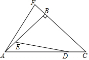
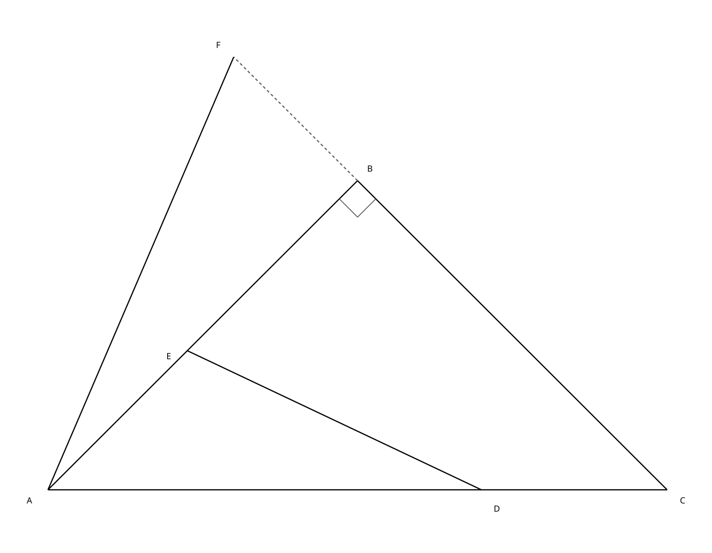

10. （2018•平房区二模）如图，在 $\triangle ABC$ 中，$\angle ABC=90^\circ$，$AB=BC$，点 $D$、$E$ 分别在 $AC$、$AB$ 边上，点 $F$ 在 $CB$ 的延长线上，$\angle BED=\angle CAF$，$AE=\sqrt{2}BF$，$BE=2AE$。若 $DE=\sqrt{19}$，则线段 $CD$ 的长为 ___ 。

> [!question]- 点击查看答案与解析
> 【答案】$CD=5-3\sqrt{2}$
>
> 【考点】等腰直角三角形的性质、全等三角形的判定与性质、勾股定理、二次根式运算 → [[【初中数学知识点体系-人教版】#15-3 等腰三角形]]、[[【初中数学知识点体系-人教版】#14-2 三角形全等的判定]]、[[【初中数学知识点体系-人教版】#20-1 勾股定理]]、[[【初中数学知识点体系-人教版】#19-1 二次根式]]
>
> 【解析】
> - 设 $AE=x$，由 $BE=2AE$ 得 $BE=2x$，故 $AB=BC=3x$；由 $AE=\sqrt{2}BF$ 得 $BF=\dfrac{x}{\sqrt{2}}$。
> 
> - 由 $\angle BED=\angle CAF$ 结合 $\angle ABC=90^\circ$、$AB=BC$，定出 $D$ 在斜边 $AC$ 上的位置；在 Rt$\triangle ADE$（相关直角三角形）中用勾股定理，由 $DE=\sqrt{19}$ 解得 $x=\sqrt{2}$，从而 $AB=BC=3\sqrt{2}$。
> - 在等腰直角 $\triangle ABC$ 中，斜边 $AC=\sqrt{2}\,AB=6$；再按 $D$ 在 $AC$ 上的位置求得 $CD=5-3\sqrt{2}$。
>
> 【易错点】$F$ 在 $CB$ 的延长线上（过 $B$ 背离 $C$ 一侧），方向不要取反；结果含二次根式，注意 $5-3\sqrt{2}>0$，勿写成 $3\sqrt{2}-5$。
