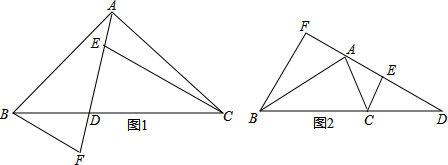
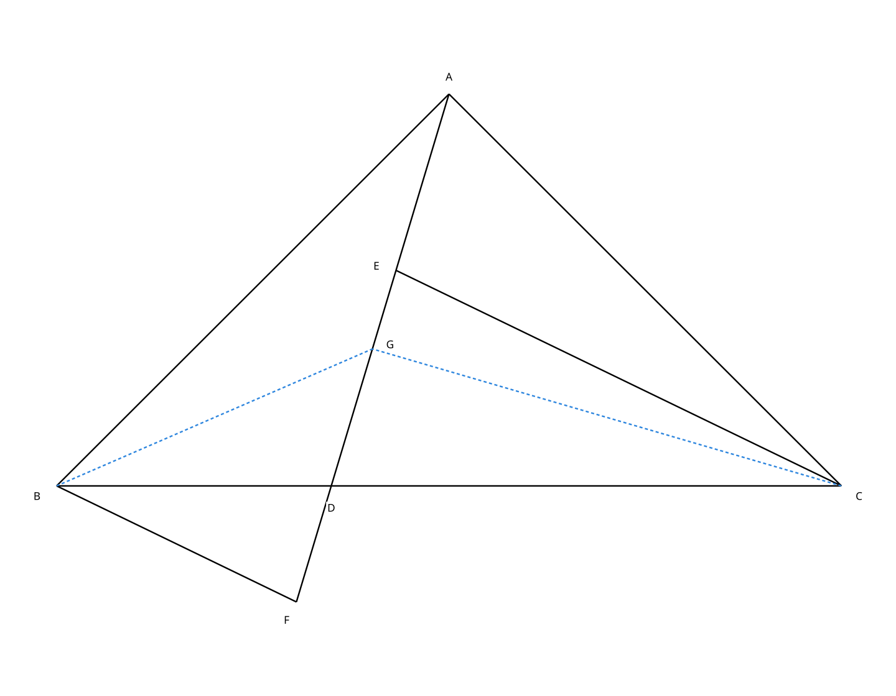

11. （2014•大连一模）如图1，$\triangle ABC$ 中，$AB=AC$，点 $D$ 在 $BC$ 上，点 $E$、$F$ 分别在 $AD$ 和 $AD$ 的延长线上，且 $\angle AEC=\angle BAC$，$BF\parallel CE$。

（1）求证：$\angle AFB$ 与 $\angle BAC$ 互补；

（2）图1中是否存在与 $AF$ 相等的线段？若存在，请找出，并加以证明，若不存在，说明理由．

（3）若把"$AB=AC$，点 $D$ 在 $BC$ 上，点 $E$、$F$ 分别在 $AD$ 和 $AD$ 的延长线上"改为"$AB=kAC$，点 $D$ 在 $BC$ 的延长线上，点 $E$、$F$ 分别在 $DA$ 和 $DA$ 的延长线上"，其他条件不变（如图2）．若 $CE=1$，$BF=3$，$\angle BAC=\alpha$，求 $AF$ 的长（用含 $k$ 和 $\alpha$ 的式子表示）．

> [!question]- 点击查看答案与解析
> 【答案】（1）$\angle AFB+\angle BAC=180^\circ$；（2）存在，$AF=CE$；（3）$AF=k-6\cos\alpha$（即 $k+6\cos(180^\circ-\alpha)$）。
>
> 【考点】等腰三角形的性质、全等三角形的判定与性质、相似三角形的判定与性质、解直角三角形（余弦） → [[【初中数学知识点体系-人教版】#15-3 等腰三角形]]、[[【初中数学知识点体系-人教版】#14-2 三角形全等的判定]]、[[【初中数学知识点体系-人教版】#31-2 相似三角形]]、[[【初中数学知识点体系-人教版】#32-2 解直角三角形及其应用]]
>
> 【解析】
> - （1）$\because BF\parallel CE$，$\therefore\angle AFB=\angle CEF$。又 $\angle CEF$ 与 $\angle AEC$ 互为邻补角，$\angle AEC=\angle BAC$，故 $\angle CEF$ 与 $\angle BAC$ 互补，从而 $\angle AFB+\angle BAC=180^\circ$。
> - （2）存在，$AF=CE$。在 $AF$ 上取一点 $G$，使 $AG=BF$。由 $\angle AFB+\angle BAC=180^\circ=\angle AFB+(\angle BAF+\angle CAF)$，又 $\angle AFB+\angle ABF+\angle BAF=180^\circ$，得 $\angle ABF=\angle CAF$。又 $AB=AC$，故 $\triangle ABF\cong\triangle CAG$（SAS），得 $AF=CG$，$\angle AFB=\angle CGA$。又 $\angle AFB=\angle CEF$，故 $\angle CGA=\angle CEF$，$CE=CG$，从而 $CE=AF$。
> 
> - （3）作 $\angle GBA=\angle EAC$，点 $G$ 在 $DA$ 的延长线上。由 $\angle AEC=\angle BAC$，得 $\angle GAB=\angle ECA$，故 $\triangle GBA\backsim\triangle EAC$，相似比 $AB:AC=k$，于是 $AG=k\cdot CE=k$，且 $\angle BGA=\angle AEC=\angle BAC=\alpha$。由 $BF\parallel CE$，$\angle BFG=180^\circ-\angle FEC=180^\circ-\alpha=\angle BGF$，故 $BG=BF=3$。作 $BH\perp FG$ 于 $H$，则 $GF=2FH=2\cdot BF\cos(180^\circ-\alpha)=-6\cos\alpha$。因此 $AF=AG+GF=k-6\cos\alpha$。
>
> 【易错点】（1）$\angle AFB$ 与 $\angle CEF$ 是同位角（相等），$\angle CEF$ 才与 $\angle AEC$ 互补，链条不要混；（2）辅助点 $G$ 在 $AF$ 上，全等为 $\triangle ABF\cong\triangle CAG$，再由 $CE=CG$ 得 $CE=AF$；（3）图2 中 $D$ 在 $BC$ 延长线上，$H$ 为等腰 $\triangle BGF$ 底边 $GF$ 的中点，$\angle BFG=180^\circ-\alpha$，余弦符号不要取错。
