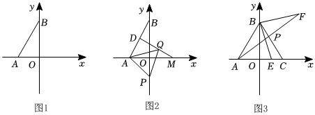
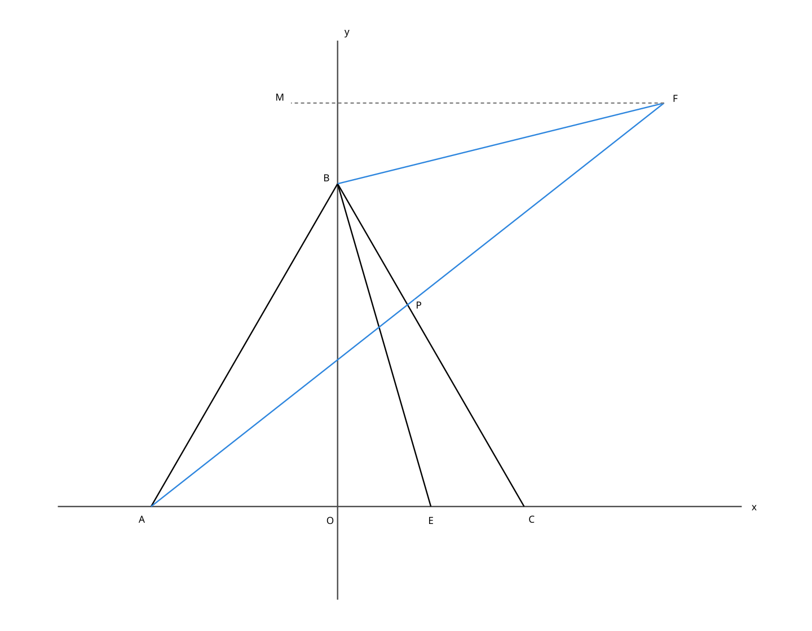

12. （2023秋•岳麓区期中）如图1，在平面直角坐标系中，点 $A$ 在 $x$ 轴负半轴上，点 $B$ 在 $y$ 轴正半轴上，设 $AB=b$，$OA=a$，$\angle BAO=60^\circ$。

（1）请写出 $a$ 和 $b$ 的数量关系；

（2）如图2，点 $D$ 为 $AB$ 的中点，点 $P$ 为 $y$ 轴负半轴上一点，以 $AP$ 为边作等边三角形 $APQ$，连接 $DQ$ 并延长交 $x$ 轴于点 $M$，若 $AB=6$，求点 $M$ 的坐标；

（3）如图3，点 $C$ 与点 $A$ 关于 $y$ 轴对称，点 $E$ 为 $OC$ 的中点，连接 $BE$，过点 $B$ 作 $\angle CBF=\angle AEB$，且 $BF=BE$，连接 $AF$ 交 $BC$ 于点 $P$，过点 $F$ 作 $FM\parallel x$ 轴交 $CB$ 的延长线于点 $M$。

$①$求证：$P$ 为 $AF$ 的中点；

$②$求 $\frac{BP}{CP}$ 的值。

> [!question]- 点击查看答案与解析
> 【答案】（1）$a=\dfrac{b}{2}$；（2）$M(3,0)$；（3）$①$ $P$ 为 $AF$ 的中点；$②$ $\dfrac{BP}{CP}=\dfrac{3}{5}$。
>
> 【考点】平面直角坐标系、含 $30^\circ$ 角的直角三角形、全等三角形的判定与性质、一次函数综合 → [[【初中数学知识点体系-人教版】#9-1 用坐标描述平面内点的位置]]、[[【初中数学知识点体系-人教版】#15-3 等腰三角形]]、[[【初中数学知识点体系-人教版】#14-2 三角形全等的判定]]、[[【初中数学知识点体系-人教版】#23-1 一次函数]]
>
> 【解析】
> - （1）Rt$\triangle AOB$ 中 $\angle AOB=90^\circ$，$\angle BAO=60^\circ$，故 $\angle ABO=30^\circ$，$30^\circ$ 角所对直角边 $OA=\dfrac{1}{2}AB$，即 $a=\dfrac{b}{2}$。
> - （2）$AB=6$，则 $OA=3$，$OB=3\sqrt{3}$，$A(-3,0)$、$B(0,3\sqrt{3})$，$D$ 为 $AB$ 中点。由等边 $\triangle APQ$ 的旋转关系，$DQ$ 所在直线与 $x$ 轴交于定点 $M(3,0)$（与 $P$ 在 $y$ 轴负半轴的位置无关）。
> - （3）$①$ 由 $C$ 与 $A$ 关于 $y$ 轴对称、$E$ 为 $OC$ 中点，结合 $\angle CBF=\angle AEB$、$BF=BE$，构造全等三角形，证得 $AF$ 与 $BC$ 的交点 $P$ 满足 $AP=PF$，即 $P$ 为 $AF$ 中点。
> - $②$ 由 $FM\parallel x$ 轴及中点结论，结合直线 $BC$ 上的线段位置关系求得线段比 $\dfrac{BP}{CP}=\dfrac{3}{5}$（与边长取值无关）。
> 
>
> 【易错点】（1）$30^\circ$ 角对的直角边是 $OA$（不是 $OB$）；（2）$Q$ 有两个旋转方向，取落在第一象限一侧；（3）注意 $M$ 在 $CB$ 的延长线上，方向不要取反。
