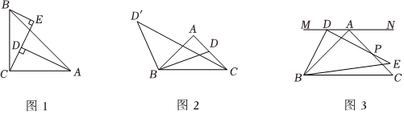
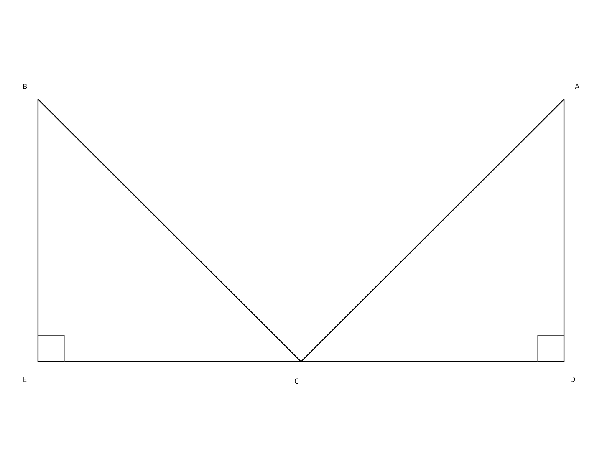

13. （2026春•市中区期中）育英中学"巅峰数学"兴趣小组对三角形全等模型展开探究．

（1）初步探究：如图1，小华绘制的 $\triangle ABC$ 中，$\angle ACB=90^\circ$，$AC=BC$，过点 $C$ 作直线 $DE$，$AD\perp DE$ 于 $D$，$BE\perp DE$ 于 $E$，求证：$\triangle ADC\cong\triangle CEB$；

（2）探究升级：如图2，小丽绘制了另外一个 $\triangle ABC$，$AB=AC$，$\angle BAC=90^\circ$，$AC$ 上取一点 $D$，连接 $BD$，线段 $BD$ 绕点 $B$ 逆时针旋转 $90^\circ$，得到线段 $BD'$，连接 $CD'$ 交直线 $AB$ 于 $G$．小丽说点 $G$ 必为线段 $CD'$ 的中点．你同意她的观点吗？请说明理由；

（3）思维发散：在等腰直角三角形 $ABC$ 中，$\angle BAC=90^\circ$，$AB=AC$，直线 $MN$ 过点 $A$ 且 $MN\parallel BC$，过点 $B$ 为一锐角顶点作 Rt△$BDE$，$\angle BDE=90^\circ$，且点 $D$ 在直线 $MN$ 上（不与点 $A$ 重合），如图3，边 $DE$ 与线段 $AC$ 交于点 $P$，连接 $BP$．试运用所学全等三角形的知识说明 $\triangle BDP$ 是等腰直角三角形。

> [!question]- 点击查看答案与解析
> 【答案】（1）$\triangle ADC\cong\triangle CEB$；（2）同意，$G$ 为 $CD'$ 的中点；（3）$\triangle BDP$ 为等腰直角三角形。
>
> 【考点】一线三垂直全等模型、旋转的性质、等腰直角三角形的判定、全等三角形的判定与性质 → [[【初中数学知识点体系-人教版】#14-2 三角形全等的判定]]、[[【初中数学知识点体系-人教版】#28-1 图形的旋转]]、[[【初中数学知识点体系-人教版】#15-3 等腰三角形]]、[[【初中数学知识点体系-人教版】#13-2 与三角形有关的线段]]
>
> 【解析】
> - （1）$\because\angle ACB=90^\circ$，$\therefore\angle ACD+\angle BCE=90^\circ$；又 $AD\perp DE$，$\therefore\angle ACD+\angle CAD=90^\circ$，故 $\angle CAD=\angle BCE$。在 $\triangle ADC$ 与 $\triangle CEB$ 中：$\angle ADC=\angle CEB=90^\circ$，$\angle CAD=\angle BCE$，$AC=CB$，故 $\triangle ADC\cong\triangle CEB$（AAS）。
> 
> - （2）同意。过 $D'$ 作 $D'H\perp AB$ 交直线 $AB$ 于 $H$。由旋转知 $BD=BD'$，$\angle DBD'=90^\circ$，故 $\angle ABD+\angle D'BH=90^\circ$，又 $\angle ABD+\angle ADB=90^\circ$，得 $\angle ADB=\angle BD'H$。于是 $\triangle BDA\cong\triangle D'BH$（AAS），得 $AD=BH$，$AB=D'H$；由 $AB=AC$ 得 $D'H=AC$。再由 $\angle CAG=\angle GHD'=90^\circ$、$\angle AGC=\angle HGD'$、$AC=D'H$，得 $\triangle ACG\cong\triangle D'HG$（AAS），故 $CG=D'G$，即 $G$ 为 $CD'$ 的中点。
> - （3）过 $D$ 作 $DH\perp AB$ 于 $H$。由 $MN\parallel BC$、$\triangle ABC$ 为等腰直角三角形，可得 $D$ 到两腰的距离关系；结合 $\angle BDE=90^\circ$（即 $DB\perp DP$），证得 $\triangle BDH\cong\triangle DPA$，从而 $BD=DP$，且 $\angle BDP=90^\circ$，故 $\triangle BDP$ 为等腰直角三角形。
>
> 【易错点】（2）辅助线 $D'H$ 交的是直线 $AB$（可能在延长线上），垂足位置不要默认在线段 $AB$ 内；（3）直角顶点在 $D$（$\angle BDP=90^\circ$），等腰的两腰是 $BD$ 与 $DP$，不要与 $BP$ 混淆。
