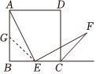
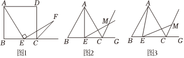
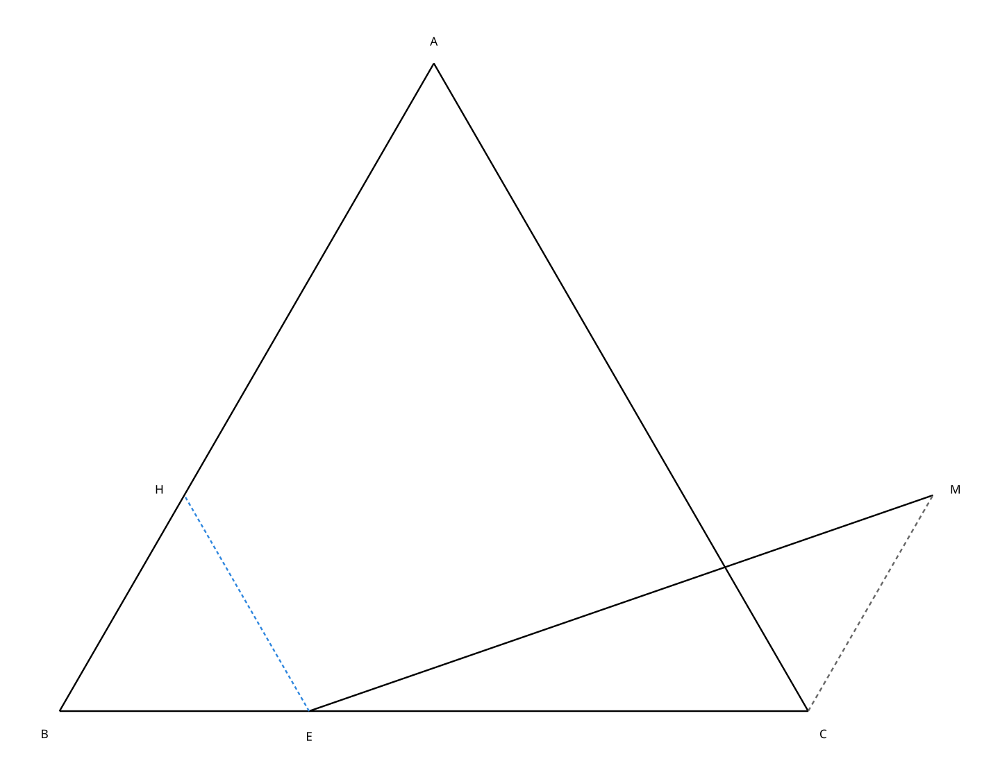

14. （2025•广西模拟）【课本再现】

如图，四边形 $ABCD$ 是正方形，点 $E$ 是边 $BC$ 的中点，$\angle AEF=90^\circ$，且 $EF$ 交正方形外角的平分线 $CF$ 于点 $F$．求证：$AE=EF$．（提示：取 $AB$ 的中点 $G$，连接 $EG$．）

证明过程如下：取边 $AB$ 中点 $G$，连接 $EG$．在正方形 $ABCD$ 中，

∵$E$ 是边 $BC$ 的中点，$G$ 是边 $AB$ 的中点，

∴$AG=EC=BG=BE$，

∴$\angle AGE=135^\circ$．

∵$CF$ 是正方形外角的平分线，

∴$\angle ECF=\angle AGE=135^\circ$．

又∵$\angle AEF=90^\circ$，

∴$\angle BAE+\angle AEB=\angle FEC+\angle AEB=90^\circ$，

∴$\angle BAE=\angle FEC$，

∴$\triangle AEG\cong\triangle EFC$，

∴$AE=EF$．

【问题解决】

（1）如图1，四边形 $ABCD$ 是正方形，$E$ 是边 $BC$ 的任一点，$\angle AEF=90^\circ$，$EF$ 交正方形外角的平分线 $CF$ 于点 $F$，结论 $AE=EF$ 是否成立？若成立，请你证明；若不成立，请说明理由；

【拓展探究】

在等边 $\triangle ABC$ 中，$E$ 为 $BC$ 边上一点，$G$ 为 $BC$ 延长线上一点，过点 $E$ 作 $\angle AEM=60^\circ$，交 $\angle ACG$ 的平分线于点 $M$．

（2）如图2，当点 $E$ 在 $BC$ 边的中点位置时，猜想 $AE$ 与 $EM$ 的数量关系： ___ ；

（3）如图3，若把条件"$E$ 是边 $BC$ 的中点"改为"$E$ 为 $BC$ 上任意一点"，其他条件不变，猜想 $AE$ 与 $EM$ 的数量关系，并说明理由．

> [!question]- 点击查看答案与解析
> 【答案】（1）成立，$AE=EF$；（2）$AE=EM$；（3）$AE=EM$。
>
> 【考点】正方形与等边三角形的性质、角平分线的定义、全等三角形的判定与性质（一线三等角模型） → [[【初中数学知识点体系-人教版】#21-2 特殊的平行四边形]]、[[【初中数学知识点体系-人教版】#15-3 等腰三角形]]、[[【初中数学知识点体系-人教版】#14-2 三角形全等的判定]]
>
> 【解析】
> - （1）成立。在 $AB$ 上截取 $AG=EC$，连接 $GE$。正方形中 $AB=BC$，故 $BG=BE$，$\triangle GBE$ 为等腰直角三角形，$\angle BGE=45^\circ$，$\angle AGE=135^\circ$；外角平分线 $CF$ 给出 $\angle ECF=135^\circ=\angle AGE$。由 $\angle AEF=90^\circ$，$\angle BAE+\angle AEB=\angle FEC+\angle AEB=90^\circ$，得 $\angle BAE=\angle FEC$。于是 $\triangle AGE\cong\triangle ECF$（ASA），$AE=EF$。
> - （2）$AE=EM$。
> - （3）$AE=EM$。在 $AB$ 上截取 $BH=BE$，连接 $HE$。等边 $\triangle ABC$ 中 $\angle B=60^\circ$，又 $BH=BE$，故 $\triangle BHE$ 为等边三角形，$\angle AHE=120^\circ$；由 $AB=BC$、$BH=BE$ 得 $AH=EC$。$CM$ 平分外角 $\angle ACG$，得 $\angle ECM=120^\circ=\angle AHE$。由 $\angle AEM=60^\circ$，结合角度推导得 $\angle HAE=\angle CEM$。于是 $\triangle AHE\cong\triangle ECM$（ASA），$AE=EM$，与 $E$ 在 $BC$ 上的位置无关。
> 
>
> 【易错点】正方形模型辅助线截 $AG=EC$，等边模型辅助线截 $BH=BE$（构造等边 $\triangle BHE$），两者位置不要混用；注意全等对应角均为钝角（$135^\circ$ / $120^\circ$），对应顶点不要配错。
