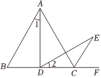
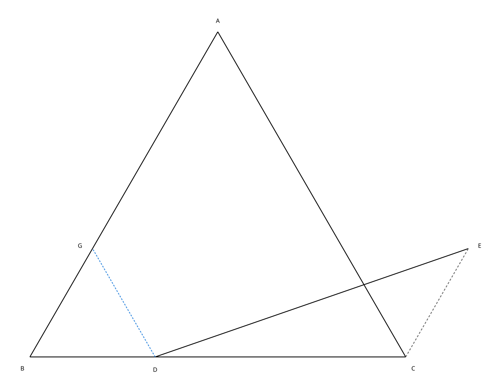

15. 如图，$\triangle ABC$ 是等边三角形，点 $D$ 是边 $BC$ 上（除点 $B$，$C$ 外）的任意一点，且 $\angle 1=\angle 2$，$\angle ADE=60^\circ$，$DE$ 交 $\triangle ABC$ 外角 $\angle ACF$ 的平分线 $CE$ 于点 $E$．求证：$AD=DE$。

> [!question]- 点击查看答案与解析
> 【答案】$AD=DE$，证明见解析。
>
> 【考点】等边三角形的性质、全等三角形的判定与性质、角平分线的定义 → [[【初中数学知识点体系-人教版】#15-3 等腰三角形]]、[[【初中数学知识点体系-人教版】#14-2 三角形全等的判定]]、[[【初中数学知识点体系-人教版】#14-3 角的平分线]]
>
> 【解析】
> - 在 $AB$ 上截取 $BG=BD$，连接 $DG$。$\triangle ABC$ 为等边三角形，$\angle B=60^\circ$，又 $BG=BD$，故 $\triangle BDG$ 为等边三角形，$\angle BGD=60^\circ$，从而 $\angle AGD=120^\circ$。
> 
> - 由 $AB=BC$、$BG=BD$，得 $AG=AB-BG=BC-BD=CD$。
> - $CE$ 平分外角 $\angle ACF$，$\angle ACF=120^\circ$，故 $\angle ACE=60^\circ$，$\angle DCE=\angle ACB+\angle ACE=120^\circ=\angle AGD$。
> - 由外角关系，$\angle ADC=\angle B+\angle BAD=60^\circ+\angle BAD$，又 $\angle ADC=\angle ADE+\angle CDE=60^\circ+\angle CDE$，故 $\angle BAD=\angle CDE$（即 $\angle 1=\angle 2$）。
> - 在 $\triangle AGD$ 与 $\triangle DCE$ 中：$\angle GAD=\angle CDE$，$AG=DC$，$\angle AGD=\angle DCE=120^\circ$，故 $\triangle AGD\cong\triangle DCE$（ASA），从而 $AD=DE$。
>
> 【易错点】辅助线是在 $AB$ 上截取 $BG=BD$ 构造等边 $\triangle BDG$，不要误在 $AC$ 上截取；注意 $\angle AGD$ 与 $\angle DCE$ 均为 $120^\circ$（钝角），对应关系不要配错。
