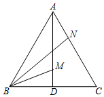
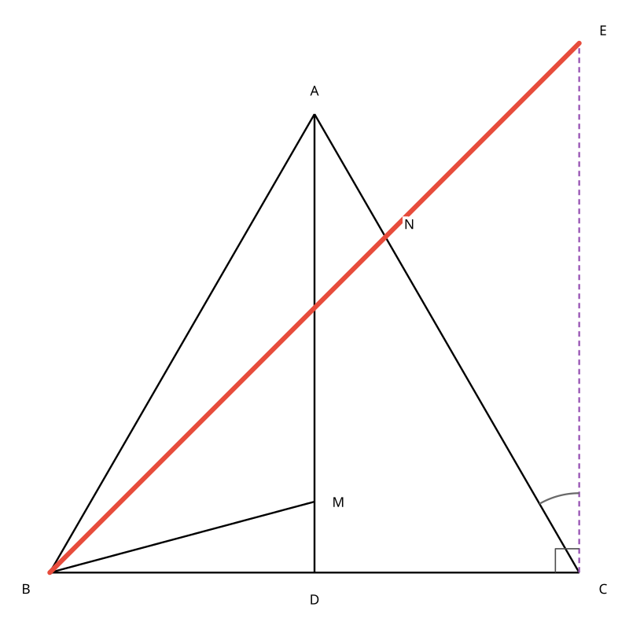

1. （2023秋•东坡区期末）如图，等边 $\triangle ABC$ 中，$AD$ 为 $BC$ 边上的高，点 $M$、$N$ 分别在 $AD$、$AC$ 上，且 $AM=CN$，连 $BM$、$BN$，当 $BM+BN$ 最小时，$\angle MBN=$ ___ 度。

> [!question]- 点击查看答案与解析
> 【答案】$30$
>
> 【考点】等边三角形的性质、全等三角形的判定与性质、轴对称最短路线（逆等线模型） → [[【初中数学知识点体系-人教版】#15-3 等腰三角形]]、[[【初中数学知识点体系-人教版】#14-2 三角形全等的判定]]、[[【初中数学知识点体系-人教版】#15-1 图形的轴对称]]
>
> 【解析】
> 在 $AC$ 右侧（$B$ 的异侧）作 $\angle ACE=30^\circ$，截取 $CE=AB$，连接 $NE$、$BE$。
> $\because AM=CN$，$\angle MAB=\angle NCE=30^\circ$（$AD$ 为等边三角形的高，平分 $\angle BAC$），$AB=CE$，
> $\therefore \triangle MAB\cong\triangle NCE$（SAS），$\therefore BM=EN$。
> $\therefore BM+BN=EN+NB\ge BE$，当 $B$、$N$、$E$ 三点共线时取最小值。
> 此时 $\angle BCE=\angle BCA+\angle ACE=60^\circ+30^\circ=90^\circ$，且 $CE=AB=BC$，
> $\therefore \triangle BCE$ 为等腰直角三角形，$\angle EBC=\angle BEC=45^\circ$，即 $\angle NBC=45^\circ$。
> 由全等得 $\angle ABM=\angle CEN=\angle CEB=45^\circ$，$\therefore \angle MBC=60^\circ-45^\circ=15^\circ$。
> $\therefore \angle MBN=\angle NBC-\angle MBC=45^\circ-15^\circ=30^\circ$。
> 
>
> 【易错点】直接对 $BM+BN$ 用"将军饮马"对称无法处理双动点；须先由 $AM=CN$ 构造全等把 $BM$ 转移为 $EN$，化双动点为单动点，再用"两点之间线段最短"。
