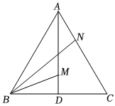
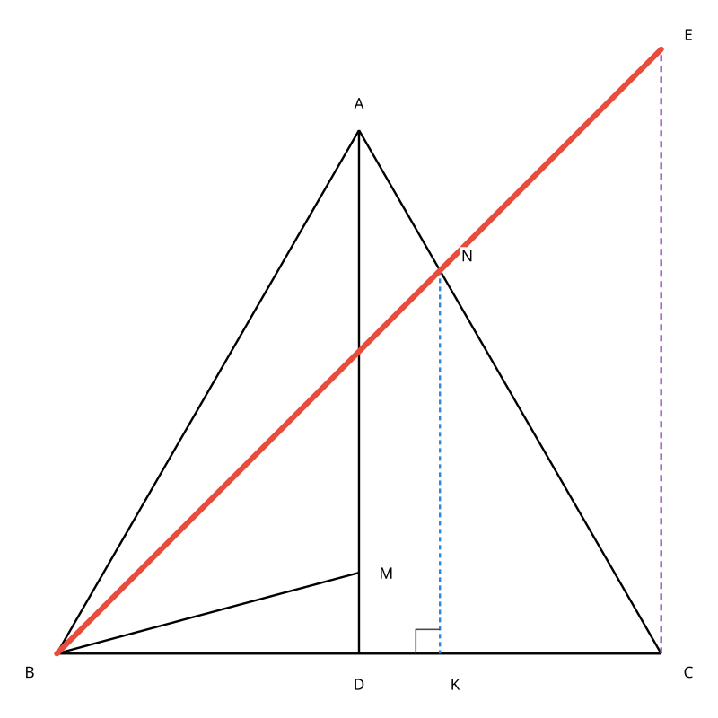

2. （2024春•成都校级期中）如图，等边 $\triangle ABC$ 中，$AD$ 为 $BC$ 边上的高，点 $M$、$N$ 分别在 $AD$、$AC$ 上，且 $AM=CN$，连 $BM$、$BN$，当 $BM+BN$ 最小时，则 $\angle BNC=$ ___ ，$\frac{S_{\triangle ABN}}{S_{\triangle BMD}}=$ ___ 。

> [!question]- 点击查看答案与解析
> 【答案】$\angle BNC=75^\circ$；$\dfrac{S_{\triangle ABN}}{S_{\triangle BMD}}=2\sqrt{3}$
>
> 【考点】等边三角形的性质、全等三角形的判定与性质、轴对称最短路线、面积计算 → [[【初中数学知识点体系-人教版】#15-3 等腰三角形]]、[[【初中数学知识点体系-人教版】#14-2 三角形全等的判定]]、[[【初中数学知识点体系-人教版】#15-1 图形的轴对称]]
>
> 【解析】
> 同第 1 题构造：在 $AC$ 右侧作 $\angle ACE=30^\circ$，$CE=AB$，则 $\triangle MAB\cong\triangle NCE$，$BM=EN$，
> $BM+BN\ge BE$，当 $B$、$N$、$E$ 共线时最小，此时 $\angle NBC=45^\circ$。
> 在 $\triangle BNC$ 中，$\angle BNC=180^\circ-\angle NBC-\angle NCB=180^\circ-45^\circ-60^\circ=75^\circ$。
> 设等边三角形边长为 $2$，则 $BD=1$，$AD=\sqrt{3}$。过 $N$ 作 $NK\perp BC$ 于 $K$。
> $\angle NBK=45^\circ\Rightarrow BK=NK$；$\angle NCK=60^\circ\Rightarrow CK=\dfrac{\sqrt{3}}{3}NK$，$CN=2CK$。
> 由 $BK+CK=2$ 得 $NK\left(1+\dfrac{\sqrt{3}}{3}\right)=2$，解得 $NK=3-\sqrt{3}$，$CK=\sqrt{3}-1$，
> $\therefore CN=2\sqrt{3}-2$，$AN=AC-CN=4-2\sqrt{3}$，$AM=CN=2\sqrt{3}-2$，$MD=AD-AM=2-\sqrt{3}$。
> $S_{\triangle ABN}=\dfrac12\cdot AN\cdot(\text{点 }B\text{ 到 }AC\text{ 的距离})=\dfrac12(4-2\sqrt{3})\cdot\sqrt{3}=2\sqrt{3}-3$；
> $S_{\triangle BMD}=\dfrac12\cdot BD\cdot MD=\dfrac{2-\sqrt{3}}{2}$。
> $\therefore \dfrac{S_{\triangle ABN}}{S_{\triangle BMD}}=\dfrac{2(2\sqrt{3}-3)}{2-\sqrt{3}}=\dfrac{2\sqrt{3}(2-\sqrt{3})}{2-\sqrt{3}}=2\sqrt{3}$。
> 
>
> 【易错点】$\angle BNC$ 是 $\triangle BNC$ 的内角，不要与共线补角 $\angle ENC$ 混淆；求面积比时高与底要对应（$\triangle ABN$ 以 $AN$ 为底，高为 $B$ 到 $AC$ 的距离即等边三角形的高）。
