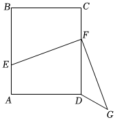
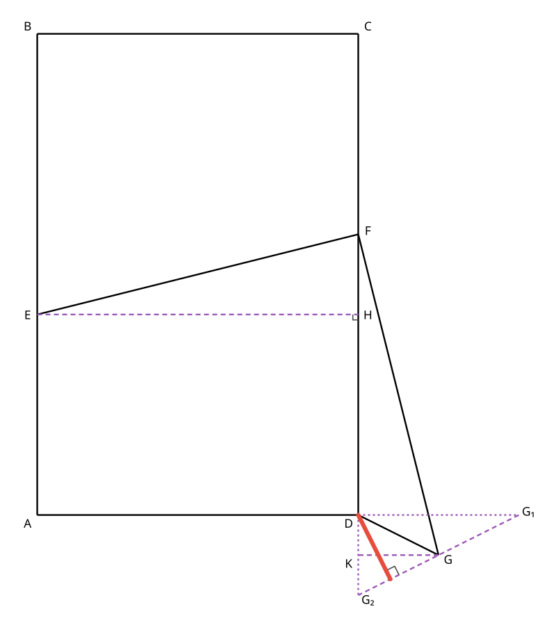

3. （2024•安徽一模）如图，矩形 $ABCD$ 中，$AB=6$，$BC=4$，点 $E$，$F$ 分别为边 $AB$，$CD$ 上的动点，且 $AE=CF$，将线段 $EF$ 绕点 $F$ 逆时针旋转 $90^\circ$ 得到线段 $FG$，连接 $DG$。

（1）当点 $E$ 为 $AB$ 的中点时，线段 $DG$ 的长是 ___ ；

（2）当点 $E$ 在边 $AB$ 上运动时，线段 $DG$ 的最小值是 ___ 。

> [!question]- 点击查看答案与解析
> 【答案】（1）$1$；（2）$\dfrac{2\sqrt{5}}{5}$
>
> 【考点】矩形的性质、旋转与全等三角形、垂线段最短、勾股定理 → [[【初中数学知识点体系-人教版】#21-2 特殊的平行四边形]]、[[【初中数学知识点体系-人教版】#14-2 三角形全等的判定]]、[[【初中数学知识点体系-人教版】#20-1 勾股定理]]
>
> 【解析】
> （1）当 $E$ 为 $AB$ 中点时，$AE=3=CF$，此时 $EF\parallel AD$，$EF\perp CD$，$EF=BC=4$，$FD=CD-CF=3$。
> 将 $EF$ 绕 $F$ 逆时针旋转 $90^\circ$，$FG$ 沿 $CD$ 方向向下，$FG=EF=4$，
> $\therefore G$ 在 $CD$ 的延长线上，$DG=FG-FD=4-3=1$。
> （2）设 $AE=CF=t$。过 $E$ 作 $EH\perp CD$ 于 $H$，过 $G$ 作 $GK\perp CD$（延长线）于 $K$。
> 由旋转 $90^\circ$ 得 $\triangle FKG\cong\triangle EHF$，$\therefore GK=FH=6-2t$，$FK=EH=4$。
> 取两个特殊位置：$t=2$ 时 $G_1$ 满足 $DG_1=2$ 且 $DG_1\perp CD$（$G_1$ 在 $AD$ 延长线上）；$t=3$ 时 $G_2$ 在 $CD$ 延长线上且 $DG_2=1$。
> 由 $GK=FH$、$FK=EH$ 的线性关系知：点 $G$ 始终在定直线 $G_1G_2$ 上运动。
> 在 $\mathrm{Rt}\triangle G_1DG_2$ 中，$DG_1=2$，$DG_2=1$，$G_1G_2=\sqrt{2^2+1^2}=\sqrt{5}$。
> 由垂线段最短，$DG$ 的最小值为点 $D$ 到直线 $G_1G_2$ 的距离，用面积法：
> $DG_{\min}=\dfrac{DG_1\cdot DG_2}{G_1G_2}=\dfrac{2\times 1}{\sqrt{5}}=\dfrac{2\sqrt{5}}{5}$。
> 
>
> 【易错点】旋转方向为逆时针，$G$ 落在 $CD$ 右侧下方；$G$ 是"从动点"，其轨迹为一条定直线，最小值是垂线段长而不是某个特殊位置的 $DG$。
