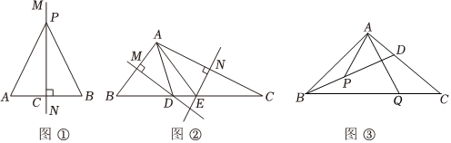
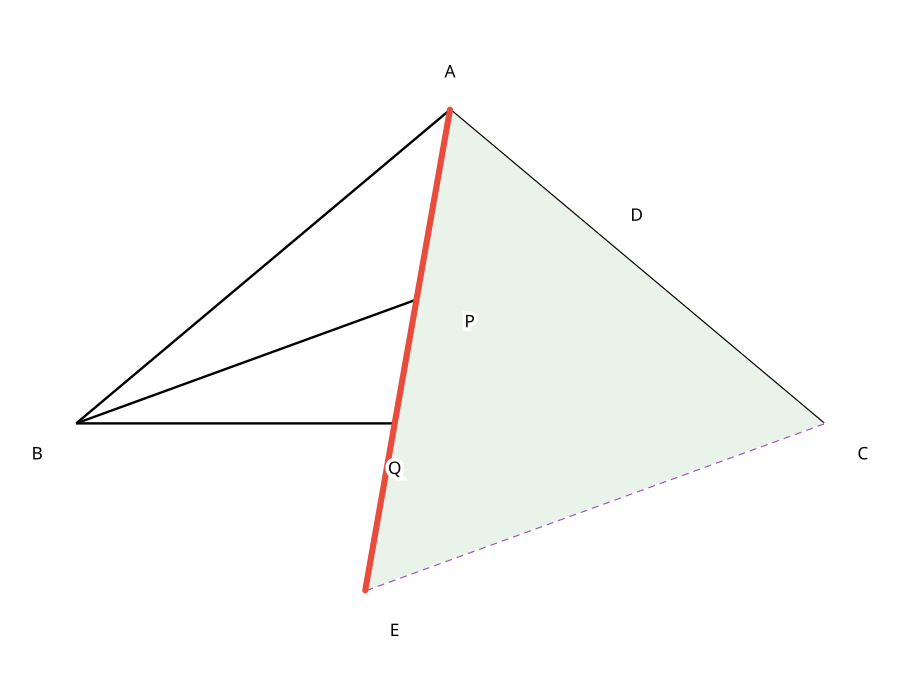

4. （2025秋•广州期中）【问题发现】

（1）如图 $①$，在 $\triangle PAB$ 中，过点 $P$ 作 $MN\perp AB$，垂足为点 $C$，且 $AC=BC$。若 $PB=6$，则 $PA$ 的值为 ___ ；

【问题探究】

（2）如图 $②$，在 $\triangle ABC$ 中，$AB$、$AC$ 的垂直平分线分别交 $BC$ 于点 $D$、$E$，垂足分别为 $M$，$N$，$BC=25$，连接 $AD$、$AE$，求 $\triangle ADE$ 的周长；

【拓展应用】

（3）如图 $③$，$\triangle ABC$ 是一个游乐场的平面示意图，$A$ 为游乐场大门，其中 $AB=AC=400$ 米，$\angle BAC=100^\circ$，$BD$ 平分 $\angle ABC$ 交 $AC$ 于点 $D$。现分别在 $BD$、$BC$ 上各取一点 $P$、$Q$，且满足 $BP=CQ$，计划沿 $AP$、$AQ$ 修建两条轨道交通以方便游客游玩，已知两条轨道造价均为每米 350 元，求修建这两条轨道总费用的最小值。

> [!question]- 点击查看答案与解析
> 【答案】（1）$6$；（2）$25$；（3）$140000$ 元
>
> 【考点】线段垂直平分线的性质、等腰三角形的性质、全等三角形与最短路线（逆等线模型） → [[【初中数学知识点体系-人教版】#15-1 图形的轴对称]]、[[【初中数学知识点体系-人教版】#15-3 等腰三角形]]、[[【初中数学知识点体系-人教版】#14-2 三角形全等的判定]]
>
> 【解析】
> （1）$\because MN\perp AB$ 且 $AC=BC$，$\therefore MN$ 是 $AB$ 的垂直平分线，$P$ 在其上，$\therefore PA=PB=6$。
> （2）$\because D$ 在 $AB$ 的垂直平分线上，$\therefore DA=DB$；同理 $EA=EC$。
> $\therefore \triangle ADE$ 的周长 $=AD+DE+EA=BD+DE+EC=BC=25$。
> （3）$\angle BAC=100^\circ$，$AB=AC\Rightarrow \angle ABC=\angle ACB=40^\circ$，$BD$ 平分 $\angle ABC\Rightarrow \angle ABD=\angle DBC=20^\circ$。
> 在 $BC$ 下方作 $\angle BCE=20^\circ$，截取 $CE=BA$，连接 $QE$、$AE$。
> $\because BP=CQ$，$\angle PBA=\angle QCE=20^\circ$，$BA=CE$，$\therefore \triangle PBA\cong\triangle QCE$（SAS），$\therefore AP=EQ$。
> $\therefore AP+AQ=EQ+QA\ge AE$，当 $A$、$Q$、$E$ 三点共线时取最小值。
> $\because \angle ACE=\angle ACB+\angle BCE=40^\circ+20^\circ=60^\circ$，且 $CA=CE$（$=AB$），
> $\therefore \triangle ACE$ 为等边三角形，$AE=AC=AB=400$ 米。
> $\therefore$ 总费用最小值 $=(AP+AQ)_{\min}\times 350=400\times 350=140000$ 元。
> 
>
> 【易错点】第（3）问造价按"每米"计，两条轨道总长即 $AP+AQ$，不要只算一条；构造全等时 $\angle BCE$ 必须作在 $BC$ 下方（$A$ 的异侧），否则折线不能拉直。
