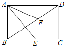
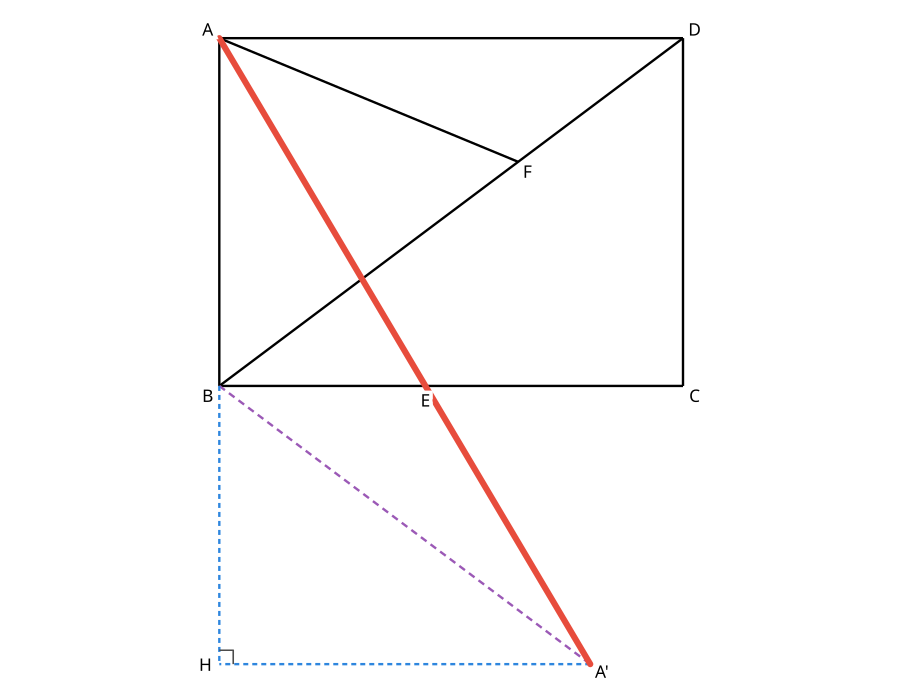

5. 如图，矩形 $ABCD$ 中，$AB=3$，$AD=4$，点 $E$、$F$ 分别是边 $BC$ 和对角线 $BD$ 上的动点，且 $BE=DF$，则 $AE+AF$ 的最小值是 ___ 。

> [!question]- 点击查看答案与解析
> 【答案】$\dfrac{\sqrt{985}}{5}$
>
> 【考点】矩形的性质、全等三角形的判定与性质、最短路线、勾股定理 → [[【初中数学知识点体系-人教版】#21-2 特殊的平行四边形]]、[[【初中数学知识点体系-人教版】#14-2 三角形全等的判定]]、[[【初中数学知识点体系-人教版】#20-1 勾股定理]]
>
> 【解析】
> 矩形中 $BD=\sqrt{AB^2+AD^2}=\sqrt{9+16}=5$。
> 在 $BC$ 下方作 $\angle A'BC=\angle ADB$，截取 $BA'=DA=4$，连接 $EA'$、$AA'$。
> $\because BE=DF$，$\angle EBA'=\angle FDA$，$BA'=DA$，$\therefore \triangle EBA'\cong\triangle FDA$（SAS），$\therefore AF=A'E$。
> $\therefore AE+AF=AE+EA'\ge AA'$，当 $A$、$E$、$A'$ 三点共线时取最小值。
> 过 $A'$ 作 $A'H\perp AB$ 的延长线于 $H$。由 $\angle A'BC=\angle ADB$ 知 $\mathrm{Rt}\triangle BHA'$ 的两直角边之比为 $AD:AB=4:3$，
> 设 $A'H=4k$，$BH=3k$，则 $(4k)^2+(3k)^2=BA'^2=16$，$k=\dfrac45$，$\therefore A'H=\dfrac{16}{5}$，$BH=\dfrac{12}{5}$。
> $AH=AB+BH=3+\dfrac{12}{5}=\dfrac{27}{5}$。
> 在 $\mathrm{Rt}\triangle AHA'$ 中，$AA'=\sqrt{AH^2+A'H^2}=\sqrt{\dfrac{729}{25}+\dfrac{256}{25}}=\dfrac{\sqrt{985}}{5}$。
> $\therefore AE+AF$ 的最小值为 $\dfrac{\sqrt{985}}{5}$。
> 
>
> 【易错点】$F$ 在对角线 $BD$ 上且 $DF=BE$（从 $D$ 起量），转移时应以 $\angle ADB$ 为基准角构造全等；$\sqrt{985}/5$ 已是最简，勿误写成 $\sqrt{39.4}$ 之外的近似值。
