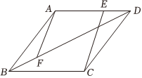
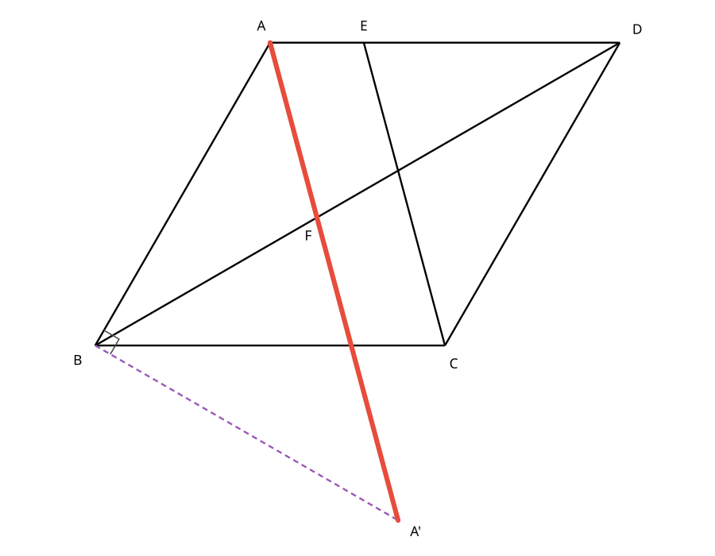

6. （2024•武汉模拟）如图，边长为 2 的菱形 $ABCD$ 中，$\angle ABC=60^\circ$，$E$，$F$ 分别是 $AD$，$BD$ 上的动点，$DE=BF$，连接 $AF$，$CE$，则 $AF+CE$ 的最小值为 ___ 。

> [!question]- 点击查看答案与解析
> 【答案】$2\sqrt{2}$
>
> 【考点】菱形的性质、全等三角形的判定与性质、最短路线、勾股定理 → [[【初中数学知识点体系-人教版】#21-2 特殊的平行四边形]]、[[【初中数学知识点体系-人教版】#14-2 三角形全等的判定]]、[[【初中数学知识点体系-人教版】#20-1 勾股定理]]
>
> 【解析】
> 菱形 $ABCD$ 中 $\angle ABC=60^\circ$，对角线 $BD$ 平分 $\angle ABC$，$\therefore \angle ABD=\angle DBC=30^\circ$，且 $\angle ADC=60^\circ$。
> 在 $BD$ 下方（$A$ 的异侧）作 $\angle A'BD=60^\circ$，截取 $BA'=DC=2$，连接 $FA'$、$AA'$。
> $\because BF=DE$，$\angle FBA'=\angle EDC=60^\circ$，$BA'=DC$，$\therefore \triangle FBA'\cong\triangle EDC$（SAS），$\therefore CE=A'F$。
> $\therefore AF+CE=AF+FA'\ge AA'$，当 $A$、$F$、$A'$ 三点共线时取最小值。
> $\because \angle ABA'=\angle ABD+\angle DBA'=30^\circ+60^\circ=90^\circ$，$AB=BA'=2$，
> $\therefore AA'=\sqrt{AB^2+BA'^2}=\sqrt{4+4}=2\sqrt{2}$。
> $\therefore AF+CE$ 的最小值为 $2\sqrt{2}$。
> 
>
> 【易错点】$\angle EDC$ 是菱形内角 $\angle ADC=60^\circ$（不是 $120^\circ$ 的 $\angle DAB$）；构造角 $\angle A'BD$ 以 $BD$ 为一边向下量取，恰好使 $\angle ABA'=90^\circ$，这是本题数据凑成 $2\sqrt{2}$ 的关键。
