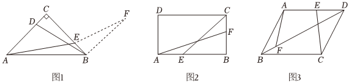
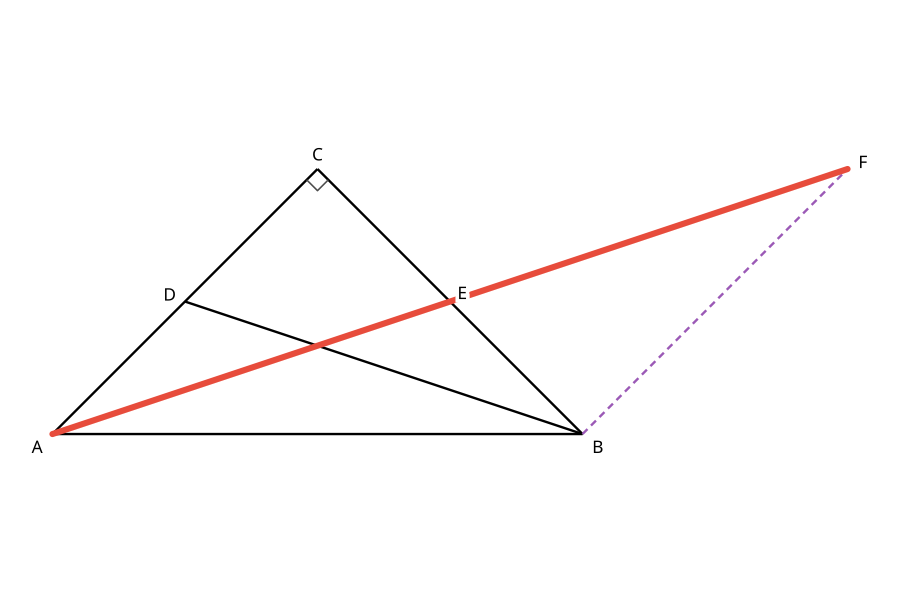
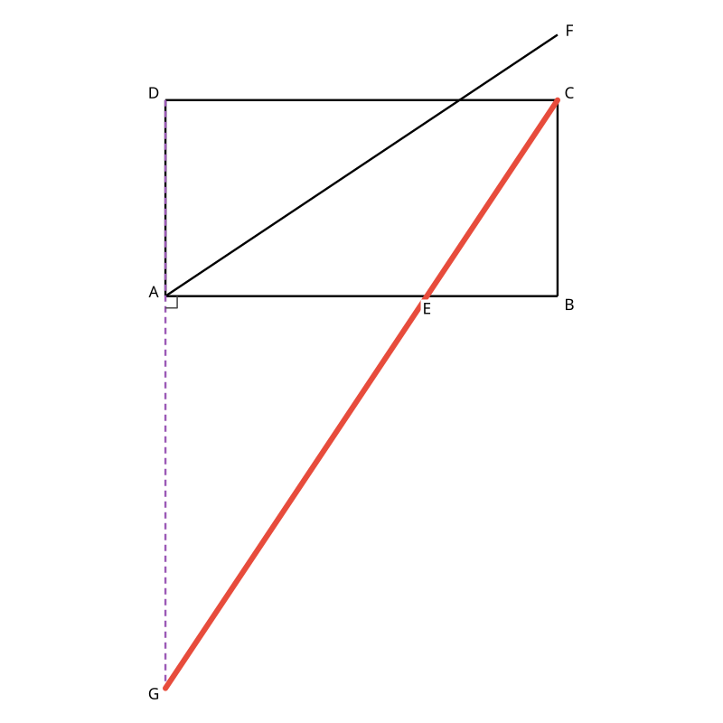
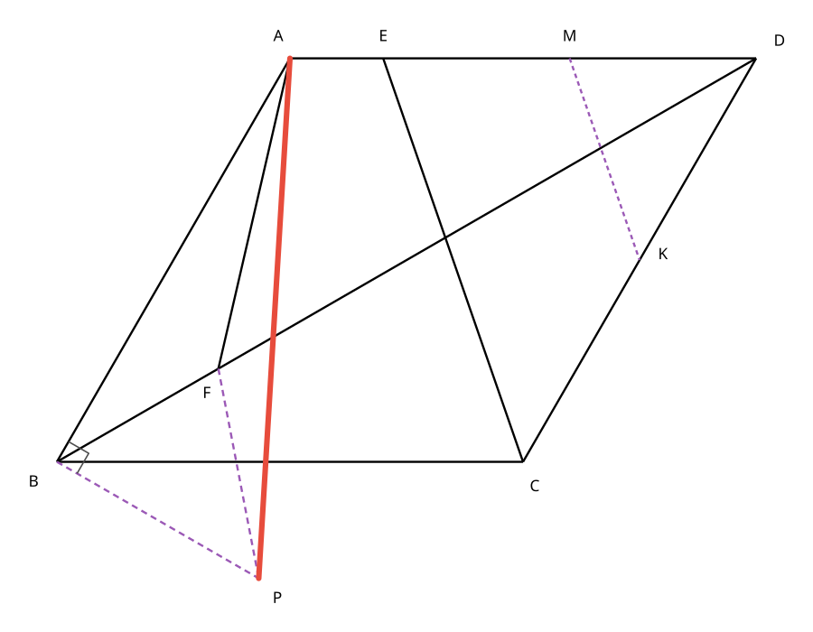

7. （2026•东兴市模拟）【概念提出】"逆等线问题"是几何最值问题中的一个热点问题。两条位置错开、长度始终相等，且分别连接一个动点和一个定点的线段，就叫"逆等线段"（简称逆等线）。它的主要特征：在某一个几何图形中，两个动点分别在两条定直线上运动，且它们分别到各自对应定点的距离始终相等。以此来求该两个动点连线的最值问题，即为"逆等线问题"。

【方法研究】

（1）如图 1，在等腰直角 $\triangle ABC$ 中，$\angle C=90^\circ$，$AC=BC=2$，$D$，$E$ 分别是线段 $AC$，$BC$ 上的两个动点。若 $CD=BE$，连接 $BD$，$AE$，试求 $BD+AE$ 的最小值。我们往往使用构造等腰三角形的方法，过点 $B$ 作 $BF\parallel AC$，且 $BF=BC$，连接 $EF$，易证 $\triangle BDC\cong\triangle FEB$，所以 $DB=EF$，由此我们可以得出结论：当 $A$，$E$，$F$ 三点 ___ 时，$EF+AE$ 的值最小，即 $BD+AE$ 取得最小值。

【问题解决】

（2）如图 2，在矩形 $ABCD$ 中，$AB=4$，$AD=2$，$E$ 是边 $AB$ 上的一个动点，$F$ 是射线 $BC$ 上的一个动点，且 $BF=AE$，连接 $AF$，$CE$，求 $AF+CE$ 的最小值（提示：在图 2 中，延长 $DA$ 至点 $G$，使 $AG=AB$，连接 $EG$）。

【拓展应用】

（3）如图 3，在菱形 $ABCD$ 中，$\angle ABC=60^\circ$，$AB=2$。若 $E$，$F$ 分别是 $AD$，$BD$ 上的两个动点，且 $BF=\frac{1}{2}DE$，连接 $AF$，$CE$，求 $2AF+CE$ 的最小值。

> [!question]- 点击查看答案与解析
> 【答案】（1）共线（$BD+AE$ 的最小值为 $2\sqrt{5}$）；（2）$2\sqrt{13}$；（3）$2\sqrt{5}$
>
> 【考点】逆等线模型、全等三角形的判定与性质、中位线、勾股定理 → [[【初中数学知识点体系-人教版】#14-2 三角形全等的判定]]、[[【初中数学知识点体系-人教版】#21-2 特殊的平行四边形]]、[[【初中数学知识点体系-人教版】#20-1 勾股定理]]
>
> 【解析】
> （1）过 $B$ 作 $BF\parallel AC$ 且 $BF=BC=2$（$F$ 与 $A$ 分居 $BC$ 两侧），连接 $EF$。
> $\because CD=BE$，$\angle DCB=\angle EBF=90^\circ$，$CB=BF$，$\therefore \triangle BDC\cong\triangle FEB$（SAS），$\therefore DB=EF$。
> $\therefore BD+AE=EF+AE\ge AF$，当 $A$、$E$、$F$ 三点共线时最小，填"共线"。
> 此时 $AF$ 可如下计算：$BF\parallel AC$，$BF=BC=AC=2$，$\angle FBC=90^\circ$，$A$、$F$ 分居 $BC$ 两侧，
> 过 $F$ 作 $BC$ 的垂线并结合 $AC\perp BC$，得 $AF=\sqrt{(AC+BF)^2+BC^2}=\sqrt{16+4}=2\sqrt{5}$。
> （2）按提示延长 $DA$ 至 $G$，使 $AG=AB=4$，连接 $EG$。
> $\because AE=BF$，$AG=BA$，$\angle GAE=\angle ABF=90^\circ$，$\therefore \triangle GAE\cong\triangle ABF$（SAS），$\therefore AF=GE$。
> $\therefore AF+CE=GE+EC\ge GC$，当 $G$、$E$、$C$ 三点共线时取最小值。
> $GD=GA+AD=4+2=6$，$DC=AB=4$，$\angle GDC=90^\circ$，
> $\therefore GC=\sqrt{GD^2+DC^2}=\sqrt{36+16}=2\sqrt{13}$。
> （3）取 $DE$ 的中点 $M$、$DC$ 的中点 $K$，则 $MK$ 是 $\triangle DEC$ 的中位线，$MK=\dfrac12 CE$，且 $DM=\dfrac12 DE=BF$。
> $\therefore 2AF+CE=2(AF+MK)$。
> 在 $BD$ 下方作 $\angle PBD=60^\circ$，截取 $BP=DK=1$，连接 $FP$、$AP$。
> $\because BF=DM$，$\angle FBP=\angle MDK=60^\circ$，$BP=DK$，$\therefore \triangle FBP\cong\triangle MDK$（SAS），$\therefore FP=MK$。
> $\therefore 2AF+CE=2(AF+FP)\ge 2AP$，当 $A$、$F$、$P$ 三点共线时取最小值。
> $\angle ABP=\angle ABD+\angle DBP=30^\circ+60^\circ=90^\circ$，$AB=2$，$BP=1$，
> $\therefore AP=\sqrt{AB^2+BP^2}=\sqrt{5}$，$\therefore 2AF+CE$ 的最小值为 $2\sqrt{5}$。
> 
> 
> 
>
> 【易错点】第（3）问系数 $2$ 提示先用中位线把 $CE$ 缩半，化为等系数逆等线再构造全等；$BF=\dfrac12 DE$ 对应 $DM=BF$，不要直接拿 $DE$ 与 $BF$ 构造全等。
