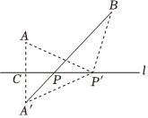
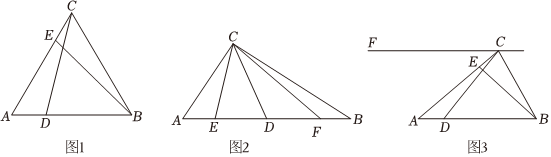
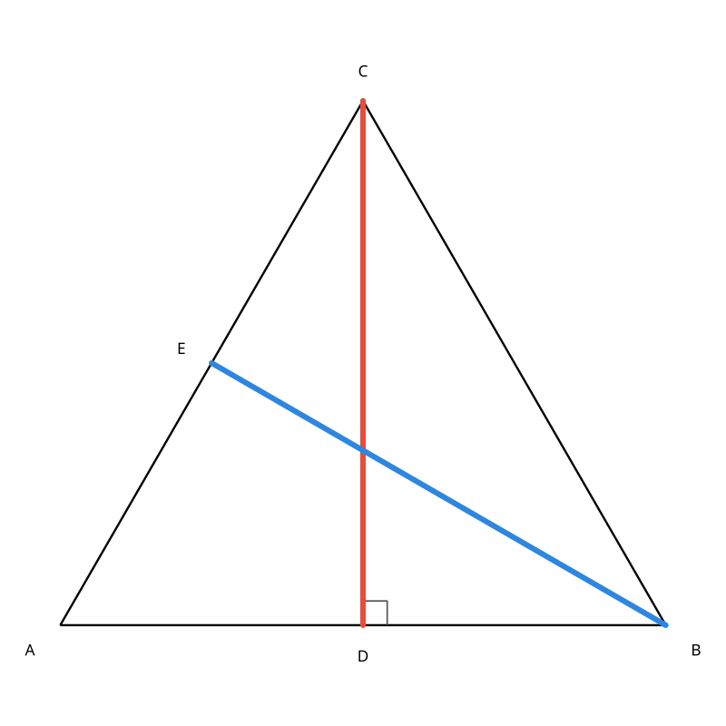
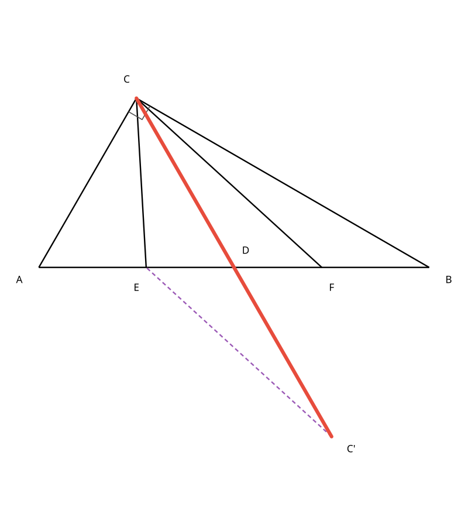
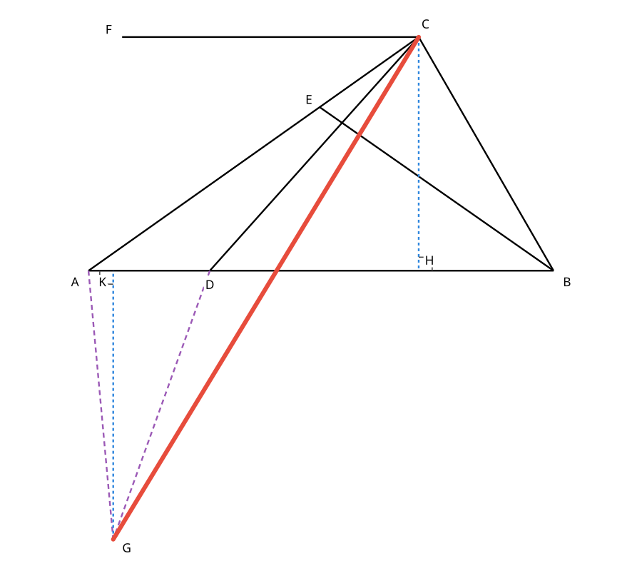

8. （2025秋•吴兴区期末）我们已经学习过"将军饮马"问题（如图），在解决该类问题时，常常利用"旋转"、"构造全等"等方法。

请据此回答下面问题：

（1）如图 1，在 $\triangle ABC$ 中，$\angle A=\angle ABC=60^\circ$，$AB=2$，点 $D$、$E$ 分别为线段 $AB$、$AC$ 上的动点，且 $AD=CE$。

$①$ 求证：$CD=BE$；

$②$ 在点 $D$、$E$ 运动过程中，求 $CD+BE$ 的最小值；

（2）如图 2，在 $\mathrm{Rt}\triangle ABC$ 中，$\angle ACB=90^\circ$，$AB=2$，$CD$ 是斜边 $AB$ 上的中线，$E$、$F$ 为线段 $AB$ 上的两个动点，且 $AE=BF$，求 $CE+CF$ 的最小值；

（3）如图 3，$AB\parallel CF$，在 $\triangle ABC$ 中，$\angle ABC=60^\circ$，$AC=3$，$BC=2$，点 $D$、$E$ 分别为线段 $AB$、$AC$ 上的动点，且 $AD=CE$，请直接写出 $CD+BE$ 的最小值。

> [!question]- 点击查看答案与解析
> 【答案】（1）$①$ 见解析；$②$ $2\sqrt{3}$；（2）$2$；（3）$\sqrt{19}$
>
> 【考点】等边三角形的判定与性质、全等三角形、斜边中线、中心对称转化、勾股定理 → [[【初中数学知识点体系-人教版】#15-3 等腰三角形]]、[[【初中数学知识点体系-人教版】#14-2 三角形全等的判定]]、[[【初中数学知识点体系-人教版】#13-2 与三角形有关的线段]]、[[【初中数学知识点体系-人教版】#20-1 勾股定理]]
>
> 【解析】
> （1）$①$ $\because \angle A=\angle ABC=60^\circ$，$\therefore \triangle ABC$ 为等边三角形，$AC=CB$，$\angle A=\angle BCE=60^\circ$。
> 又 $AD=CE$，$\therefore \triangle ACD\cong\triangle CBE$（SAS），$\therefore CD=BE$。
> $②$ $CD+BE=2CD$，当 $CD\perp AB$ 时 $CD$ 最小（垂线段最短），此时 $D$ 为 $AB$ 中点，$CD=\sqrt{AC^2-AD^2}=\sqrt{4-1}=\sqrt{3}$，
> 对应 $CE=AD=1\le AC$，可以取到，$\therefore$ 最小值 $2\sqrt{3}$。
> （2）取 $AB$ 中点即 $D$（$CD$ 为斜边中线），作 $C$ 关于点 $D$ 的对称点 $C'$，连接 $C'E$、$CC'$。
> $\because AE=BF$，$D$ 为 $AB$ 中点，$\therefore DE=DF$；又 $DC=DC'$，$\angle CDF=\angle C'DE$（对顶角），
> $\therefore \triangle CDF\cong\triangle C'DE$（SAS），$\therefore CF=C'E$。
> $\therefore CE+CF=CE+EC'\ge CC'=2CD=AB=2$（直角三角形斜边中线等于斜边一半），
> 当 $E$、$F$ 都与 $D$ 重合时取最小值 $2$。
> （3）在 $AB$ 下方（$C$ 的异侧）作 $\angle GAB=\angle ACB$，截取 $AG=CB=2$，连接 $DG$、$CG$。
> $\because AD=CE$，$\angle DAG=\angle ECB$，$AG=CB$，$\therefore \triangle DAG\cong\triangle ECB$（SAS），$\therefore BE=GD$。
> $\therefore CD+BE=CD+DG\ge CG$，当 $C$、$D$、$G$ 三点共线时取最小值。
> 计算 $CG$：作 $CH\perp AB$ 于 $H$，$GK\perp AB$ 于 $K$。$\angle ABC=60^\circ$，$BC=2\Rightarrow BH=1$，$CH=\sqrt{3}$；
> $AH=\sqrt{AC^2-CH^2}=\sqrt{9-3}=\sqrt{6}$，$AB=1+\sqrt{6}$。
> 由面积法 $S_{\triangle ABC}=\dfrac12 AB\cdot CH=\dfrac12 CA\cdot CB\cdot\sin\angle ACB$ 得 $\sin\angle ACB=\dfrac{(1+\sqrt{6})\sqrt{3}}{6}$，
> $\therefore GK=AG\sin\angle GAB=\dfrac{3\sqrt{2}+\sqrt{3}}{3}$，$AK=\sqrt{AG^2-GK^2}=\dfrac{3-\sqrt{6}}{3}$。
> $CG^2=(AH-AK)^2+(CH+GK)^2=\dfrac{(4\sqrt{6}-3)^2+(4\sqrt{3}+3\sqrt{2})^2}{9}=\dfrac{171}{9}=19$，
> $\therefore$ 最小值 $CG=\sqrt{19}$。
> 
> 
> 
>
> 【易错点】第（2）问最小值与 $\angle A$ 大小无关，本质是 $2CD=AB$；取等时 $E$、$F$ 重合于中点 $D$，是允许的（题目未要求 $E\ne F$）。第（3）问 $\angle GAB$ 对应的是 $\angle ACB$ 而不是 $60^\circ$ 的 $\angle ABC$。
