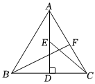
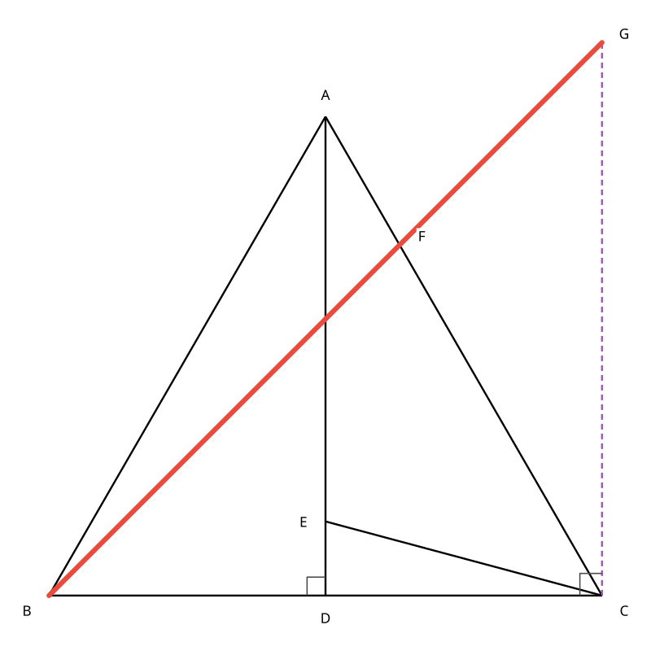

9. （2026•石河子一模）如图，$AD$ 是等边 $\triangle ABC$ 的高，$AB=3$，$E$，$F$ 分别是线段 $AD$，$AC$ 上动点，且 $AE=CF$，则 $BF+CE$ 的最小值为 ___ 。

> [!question]- 点击查看答案与解析
> 【答案】$3\sqrt{2}$
>
> 【考点】等边三角形的性质、轴对称、全等三角形与最短路线、勾股定理 → [[【初中数学知识点体系-人教版】#15-3 等腰三角形]]、[[【初中数学知识点体系-人教版】#15-1 图形的轴对称]]、[[【初中数学知识点体系-人教版】#14-2 三角形全等的判定]]、[[【初中数学知识点体系-人教版】#20-1 勾股定理]]
>
> 【解析】
> $\because AD$ 是等边 $\triangle ABC$ 的高，$\therefore AD$ 是对称轴，$B$、$C$ 关于 $AD$ 对称，$\therefore CE=BE$。
> $\therefore BF+CE=BF+BE$，其中 $AE=CF$。
> 在 $AC$ 右侧（$B$ 的异侧）作 $\angle FCG=\angle EAB=30^\circ$，截取 $CG=AB=3$，连接 $FG$、$BG$。
> $\because CF=AE$，$\angle FCG=\angle EAB$，$CG=AB$，$\therefore \triangle FCG\cong\triangle EAB$（SAS），$\therefore BE=GF$。
> $\therefore BF+CE=BF+FG\ge BG$，当 $B$、$F$、$G$ 三点共线时取最小值。
> $\because \angle BCG=\angle BCA+\angle ACG=60^\circ+30^\circ=90^\circ$，$CG=AB=BC=3$，
> $\therefore BG=\sqrt{BC^2+CG^2}=\sqrt{9+9}=3\sqrt{2}$。
> $\therefore BF+CE$ 的最小值为 $3\sqrt{2}$。
> 
>
> 【易错点】先用对称把 $CE$ 换成 $BE$，统一到从 $B$ 出发的两条线段，再构造全等转移；$\angle FCG$ 的基准边是 $CA$，向 $B$ 的异侧量取 $30^\circ$。
