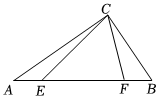
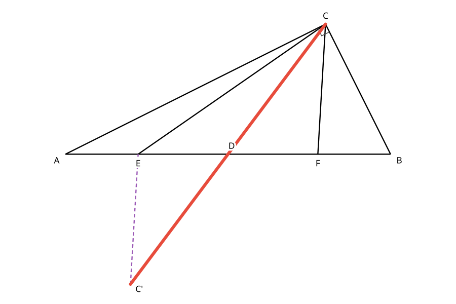

10. （2024秋•东莞市校级期中）如图，在 $\mathrm{Rt}\triangle ABC$ 中，$\angle ACB=90^\circ$，$AC=4$，$BC=2$，点 $E$、$F$ 是线段 $AB$ 上的动点，且满足 $AE=BF$，连接 $CE$，$CF$，则 $CE+CF$ 的最小值是 ___ 。

> [!question]- 点击查看答案与解析
> 【答案】$2\sqrt{5}$
>
> 【考点】直角三角形斜边中线、中心对称（平行四边形）转化、最短路线、勾股定理 → [[【初中数学知识点体系-人教版】#13-2 与三角形有关的线段]]、[[【初中数学知识点体系-人教版】#21-1 平行四边形]]、[[【初中数学知识点体系-人教版】#20-1 勾股定理]]
>
> 【解析】
> 取 $AB$ 中点 $D$，作 $C$ 关于点 $D$ 的对称点 $C'$，连接 $C'E$、$CC'$。
> $\because AE=BF$，$AD=BD$，$\therefore DE=DF$；又 $DC=DC'$，$\angle CDF=\angle C'DE$（对顶角），
> $\therefore \triangle CDF\cong\triangle C'DE$（SAS），$\therefore CF=C'E$。
> $\therefore CE+CF=CE+EC'\ge CC'=2CD$，当 $E$、$F$ 都与 $D$ 重合时取最小值。
> $\because \angle ACB=90^\circ$，$CD$ 为斜边中线，$\therefore CD=\dfrac12 AB=\dfrac12\sqrt{AC^2+BC^2}=\dfrac12\sqrt{16+4}=\sqrt{5}$。
> $\therefore$ 最小值 $CC'=2CD=2\sqrt{5}$。
> 
>
> 【易错点】$AE=BF$ 意味着 $E$、$F$ 关于中点 $D$ 对称，用"关于点的中心对称"转移 $CF$，而不是关于直线 $AB$ 翻折；最小值恰为斜边 $AB$ 的长。
