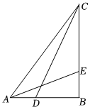
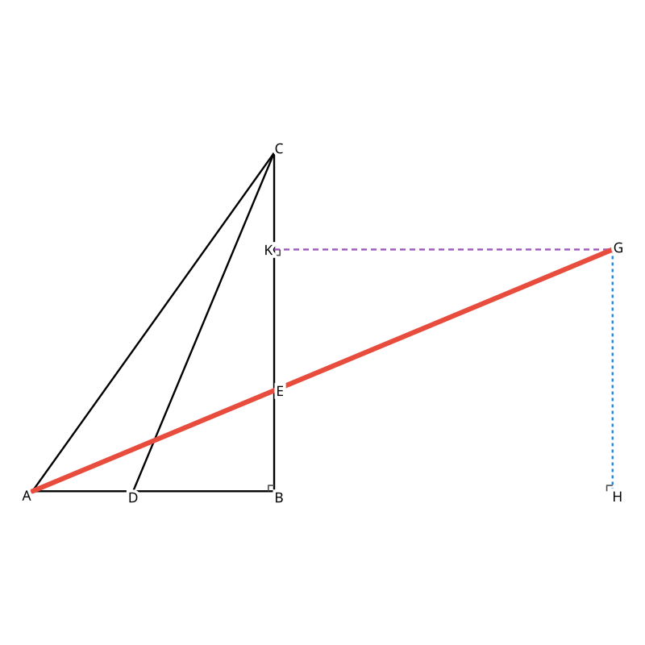

11. （2024春•历城区期末）如图，已知 $\mathrm{Rt}\triangle ABC$，$\angle ABC=90^\circ$，$AB=5$，$BC=7$，点 $D$，$E$ 分别是 $AB$，$BC$ 边上的动点，满足 $AD=BE$。连接 $AE$，$CD$，则 $AE+CD$ 的最小值为（　　）

A. $12$

B. $13$

C. $14$

D. $15$

> [!question]- 点击查看答案与解析
> 【答案】B
>
> 【考点】全等三角形的判定与性质、最短路线、勾股定理 → [[【初中数学知识点体系-人教版】#14-2 三角形全等的判定]]、[[【初中数学知识点体系-人教版】#20-1 勾股定理]]、[[【初中数学知识点体系-人教版】#15-1 图形的轴对称]]
>
> 【解析】
> 在 $BC$ 上截取 $BK=AB=5$，过 $K$ 作 $KG\perp BC$ 向右（$A$ 的异侧），截取 $KG=BC=7$，连接 $EG$、$AG$。
> $\because AD=BE$，$\therefore BD=AB-AD=5-BE=BK-BE=EK$（当 $E$ 在 $B$、$K$ 之间时；$E$ 在 $K$ 右侧时同理取长度）。
> 在 $\mathrm{Rt}\triangle EKG$ 与 $\mathrm{Rt}\triangle DBC$ 中，$EK=DB$，$KG=BC$，$\angle EKG=\angle DBC=90^\circ$，
> $\therefore \triangle EKG\cong\triangle DBC$（SAS），$\therefore CD=GE$。
> $\therefore AE+CD=AE+EG\ge AG$，当 $A$、$E$、$G$ 三点共线时取最小值。
> 过 $G$ 作 $GH\perp AB$ 的延长线于 $H$，则 $GH=BK=5$，$BH=KG=7$，$AH=AB+BH=5+7=12$。
> $\therefore AG=\sqrt{AH^2+GH^2}=\sqrt{144+25}=13$。
> 逐项核对：最小值恰为 $13$，A（$12$）、C（$14$）、D（$15$）均不符，故选 B。
> 
>
> 【易错点】转移 $CD$ 时对应的直角边是 $BD=5-BE$ 而不是 $BE$，故辅助点 $K$ 满足 $BK=AB$；$A$、$G$ 分居 $BC$ 两侧才能拉直取等。
