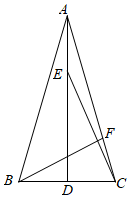
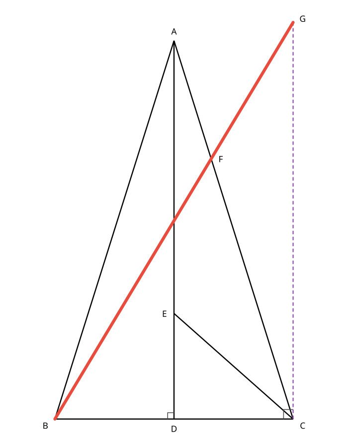

12. （2021秋•任城区校级期末）如图，$AD$ 为等腰 $\triangle ABC$ 的高，$AB=AC=5$，$BC=3$，$E$、$F$ 分别为线段 $AD$、$AC$ 上的动点，且 $AE=CF$，则 $BF+CE$ 的最小值为 ___ 。

> [!question]- 点击查看答案与解析
> 【答案】$\sqrt{34}$
>
> 【考点】等腰三角形的性质、轴对称、全等三角形与最短路线、勾股定理 → [[【初中数学知识点体系-人教版】#15-3 等腰三角形]]、[[【初中数学知识点体系-人教版】#15-1 图形的轴对称]]、[[【初中数学知识点体系-人教版】#14-2 三角形全等的判定]]、[[【初中数学知识点体系-人教版】#20-1 勾股定理]]
>
> 【解析】
> $\because AB=AC$，$AD$ 为高，$\therefore AD$ 是对称轴，$CE=BE$，$\therefore BF+CE=BF+BE$，其中 $AE=CF$。
> 在 $AC$ 右侧（$B$ 的异侧）作 $\angle FCG=\angle EAB$（即 $\dfrac12\angle BAC$），截取 $CG=AB=5$，连接 $FG$、$BG$。
> $\because CF=AE$，$\angle FCG=\angle EAB$，$CG=AB$，$\therefore \triangle FCG\cong\triangle EAB$（SAS），$\therefore BE=GF$。
> $\therefore BF+CE=BF+FG\ge BG$，当 $B$、$F$、$G$ 三点共线时取最小值。
> $\because AD$ 平分 $\angle BAC$，$\therefore \angle DAC=\dfrac12\angle BAC$，$\angle ACB=90^\circ-\dfrac12\angle BAC$。
> $\because F$ 在 $AC$ 上，$\therefore \angle GCA=\angle GCF=\dfrac12\angle BAC$（构造角），
> $\therefore \angle GCB=\angle GCA+\angle ACB=\dfrac12\angle BAC+\left(90^\circ-\dfrac12\angle BAC\right)=90^\circ$，即 $GC\perp BC$。
> $\therefore BG=\sqrt{BC^2+CG^2}=\sqrt{9+25}=\sqrt{34}$。
> $\therefore BF+CE$ 的最小值为 $\sqrt{34}$。
> 
>
> 【易错点】本题不是等边三角形，$\angle FCG=\dfrac12\angle BAC\ne 30^\circ$；但仍有 $GC\perp BC$（因 $\angle ACB=90^\circ-\dfrac12\angle BAC$），故可直接用勾股定理。
