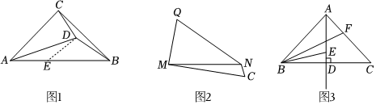
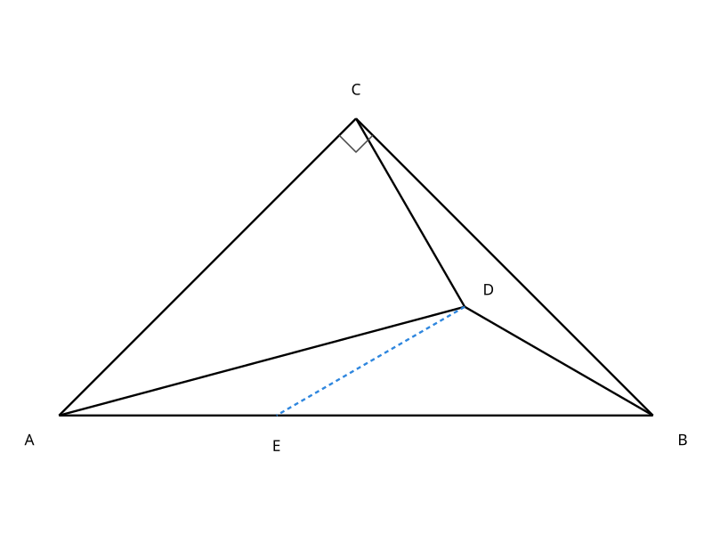
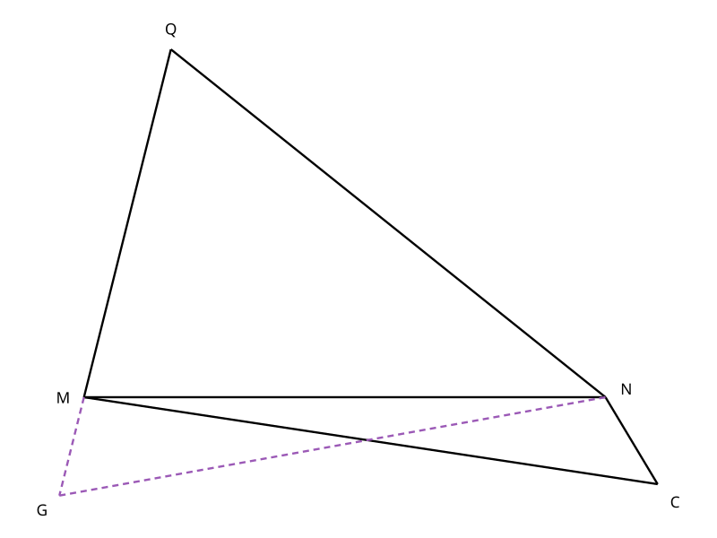
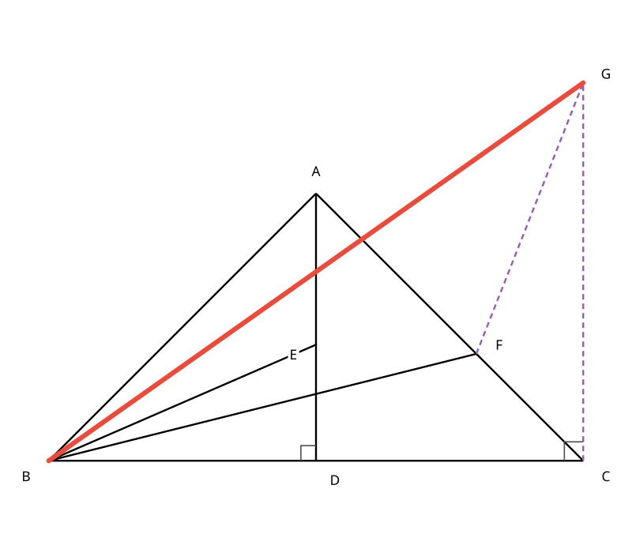

13. （2026春•法库县期中）（1）如图 1，已知等腰直角三角形中，$AC=BC$，在三角形内取一点 $D$，使得 $AD=AC$，$\angle CAD=30^\circ$，求 $\angle ADB$ 的度数；

小亮通过挖掘已知条件，获得 $\angle DAB=\angle DCB=15^\circ$，线段 $BC=AD$，这样本题就具备了一边一角的图形特征，所以小明果断地在 $AB$ 上截取 $AE=CD$，构造出全等三角形，从而使问题得以解决。请按照小亮的思路完整解答；

（2）如图 2，在四边形 $MCNQ$ 中，$\angle MNC+\angle QMN=180^\circ$，$\angle C=\angle Q$，求证：$MC=NQ$；小亮深入研究已知条件，迅速想到：延长 $QM$ 到点 $G$，使得 $MG=NC$，连接 $GN$，从而使问题得以解决。请按照小亮的思路完整解答；

（3）如图 3，在 $\triangle ABC$ 中，$\angle BAC=90^\circ$，$AB=AC=2$，射线 $AD\perp BC$ 于点 $D$。若点 $E$，$F$ 分别是射线 $AD$，边 $AC$ 上的动点，$AE=CF$，连接 $BE$，$BF$，直接写出 $BE+BF$ 最小值。

> [!question]- 点击查看答案与解析
> 【答案】（1）$\angle ADB=135^\circ$；（2）见解析；（3）$2\sqrt{3}$
>
> 【考点】等腰直角三角形的性质、全等三角形的判定与性质、三角形内角和、最短路线 → [[【初中数学知识点体系-人教版】#15-3 等腰三角形]]、[[【初中数学知识点体系-人教版】#14-2 三角形全等的判定]]、[[【初中数学知识点体系-人教版】#13-3 三角形的内角与外角]]、[[【初中数学知识点体系-人教版】#20-1 勾股定理]]
>
> 【解析】
> （1）设等腰直角三角形为 $\triangle ACB$，$\angle ACB=90^\circ$，$AC=BC$。
> $\because \angle CAD=30^\circ$，$\therefore \angle DAB=45^\circ-30^\circ=15^\circ$；$\triangle ACD$ 中 $AD=AC$，$\angle ACD=\angle ADC=\dfrac{180^\circ-30^\circ}{2}=75^\circ$，$\therefore \angle DCB=90^\circ-75^\circ=15^\circ$。
> 过 $D$ 作 $DH\perp AC$ 于 $H$。在 $\mathrm{Rt}\triangle ADH$ 中 $\angle DAH=30^\circ$，由"30° 角所对直角边等于斜边一半"得 $DH=\dfrac12 AD=\dfrac12 BC$，
> $\therefore D$ 到 $AC$ 的距离等于 $\dfrac12 BC$，即 $D$ 在 $BC$ 的垂直平分线上，$\therefore DB=DC$，$\angle DBC=\angle DCB=15^\circ$，$\angle BDC=150^\circ$。
> 在 $AB$ 上截取 $AE=CD$，连接 $DE$。$\because AD=CB$，$\angle DAE=\angle BCD=15^\circ$，$AE=CD$，
> $\therefore \triangle DAE\cong\triangle BCD$（SAS），$\therefore DE=BD$，$\angle ADE=\angle CBD=15^\circ$，$\angle AED=\angle CDB=150^\circ$。
> $\therefore \angle DEB=180^\circ-150^\circ=30^\circ$；$\triangle DEB$ 中 $DE=DB$，$\therefore \angle DBE=\angle DEB=30^\circ$，$\angle EDB=120^\circ$。
> $\therefore \angle ADB=\angle ADE+\angle EDB=15^\circ+120^\circ=135^\circ$。
> （2）延长 $QM$ 至 $G$，使 $MG=NC$，连接 $GN$。
> $\because \angle MNC+\angle QMN=180^\circ$，$\angle GMN+\angle QMN=180^\circ$，$\therefore \angle GMN=\angle MNC$。
> 又 $MG=NC$，$MN=NM$，$\therefore \triangle GMN\cong\triangle CNM$（SAS），$\therefore GN=CM$，$\angle G=\angle C$。
> $\because \angle C=\angle MQN$，且 $G$ 在射线 $QM$ 的延长线上，$\angle GQN=\angle MQN$，
> $\therefore \angle G=\angle GQN$，$\therefore NQ=GN$（等角对等边），$\therefore MC=NQ$。
> （3）$\because AB=AC$，$\angle BAC=90^\circ$，$AD\perp BC$，$\therefore AD$ 是对称轴，$BE=CE$，$\therefore BE+BF=CE+BF$，其中 $AE=CF$。
> 在 $AC$ 右侧（$B$ 的异侧）作 $\angle FCG=\angle EAC=45^\circ$，截取 $CG=AC=2$，连接 $FG$、$BG$。
> $\triangle FCG\cong\triangle EAC$（SAS）$\Rightarrow CE=GF$，$\therefore BE+BF=BF+FG\ge BG$。
> $\angle BCG=\angle BCA+\angle ACG=45^\circ+45^\circ=90^\circ$，$BC=\sqrt{AB^2+AC^2}=2\sqrt{2}$，$CG=2$，
> $\therefore BG=\sqrt{BC^2+CG^2}=\sqrt{8+4}=2\sqrt{3}$，即最小值 $2\sqrt{3}$。
> 
> 
> 
>
> 【易错点】第（1）问关键是发现 $DB=DC$（$D$ 在 $BC$ 中垂线上），否则角度链推不下去；第（3）问 $E$ 在射线 $AD$ 上，取等时 $AE=CF\approx1.66>AD=\sqrt{2}\approx1.41$，$E$ 在 $AD$ 的延长线上（仍在射线 $AD$ 上，故可取到）。
