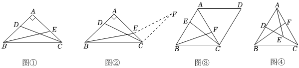
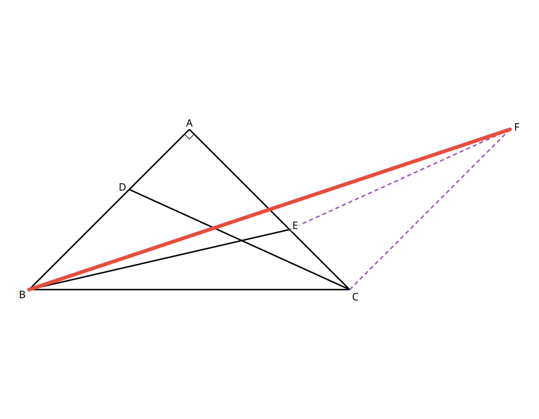
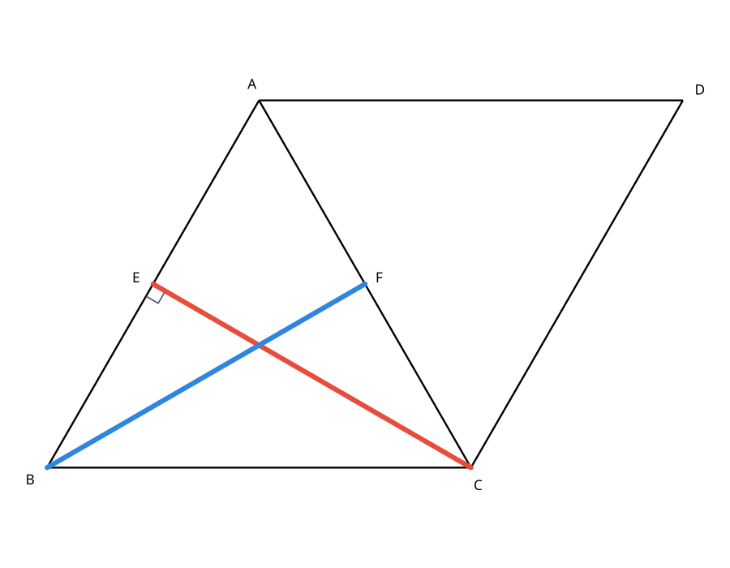
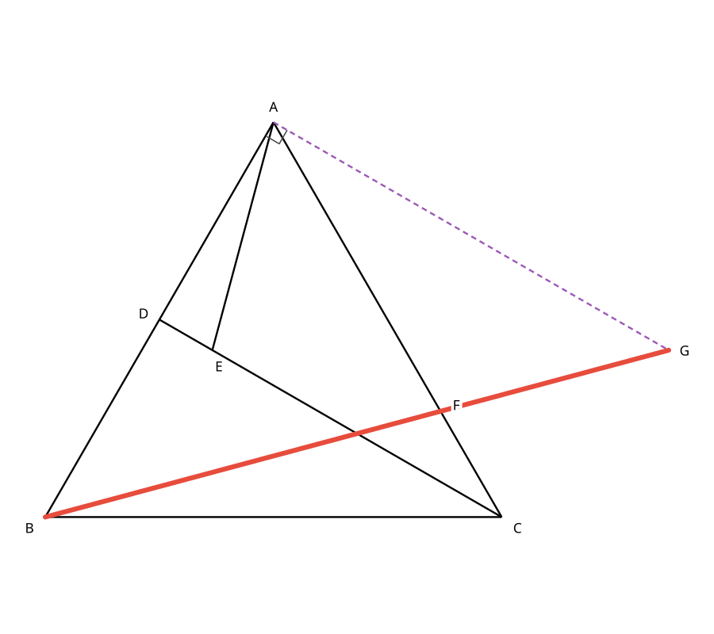

14. （2025•朝阳区校级三模）【问题呈现】小明在做一道数学题时遇到了一个问题：如图 $①$，在等腰直角 $\triangle ABC$ 中，$\angle BAC=90^\circ$，$AB=AC=4$。$D$、$E$ 分别是边 $AB$、$AC$ 上的两个动点，$AD=CE$。连结 $BE$、$CD$，试探究 $BE+CD$ 的最小值。

【问题分析】小明通过构造全等三角形，将双动点问题转化为单动点问题，利用 $B$、$E$、$F$ 三点共线，将上述问题解决。

【问题解决】如图 $②$，过 $C$ 点作 $CF\parallel AB$，且 $CF=AC$，连结 $EF$；在【问题呈现】的条件下，完成下列问题：

（1）证明：$\triangle ACD\cong\triangle CFE$。

（2）$BE+CD$ 的最小值为 ___ 。

【方法运用】如图 $③$，在菱形 $ABCD$ 中，$AB=3$，$\angle D=60^\circ$，$E$、$F$ 分别是边 $AB$、$AC$ 上的两个动点，$AE=CF$。连结 $BF$、$CE$，则 $BF+CE$ 的最小值为 ___ 。

【拓展迁移】如图 $④$，在等边 $\triangle ABC$ 中，$CD$ 是高，点 $E$ 在线段 $CD$ 上，点 $F$ 在边 $AC$ 上，$CE=AF$，连结 $AE$，$BF$，若 $AB=2\sqrt{3}$，则 $AE+BF$ 的最小值为 ___ 。

> [!question]- 点击查看答案与解析
> 【答案】（1）见解析；（2）$4\sqrt{5}$；【方法运用】$3\sqrt{3}$；【拓展迁移】$2\sqrt{6}$
>
> 【考点】全等三角形的判定与性质、等腰直角三角形、菱形与等边三角形、最短路线、勾股定理 → [[【初中数学知识点体系-人教版】#14-2 三角形全等的判定]]、[[【初中数学知识点体系-人教版】#15-3 等腰三角形]]、[[【初中数学知识点体系-人教版】#21-2 特殊的平行四边形]]、[[【初中数学知识点体系-人教版】#20-1 勾股定理]]
>
> 【解析】
> （1）$\because CF\parallel AB$，$\angle BAC=90^\circ$，$\therefore CF\perp AC$，即 $\angle FCE=90^\circ=\angle DAC$。
> 又 $CF=AC$，$CE=AD$，$\therefore \triangle ACD\cong\triangle CFE$（SAS）。
> （2）由（1）$CD=FE$，$\therefore BE+CD=BE+EF\ge BF$，当 $B$、$E$、$F$ 三点共线时取最小值。
> $\angle BCF=\angle BCA+\angle ACF=45^\circ+90^\circ=135^\circ$，用勾股计算：过 $F$ 作 $FH\perp BC$ 的延长线于 $H$，
> $\angle FCH=45^\circ$，$CF=4\Rightarrow CH=FH=2\sqrt{2}$；$BC=4\sqrt{2}$，
> $\therefore BF=\sqrt{(BC+CH)^2+FH^2}=\sqrt{(6\sqrt{2})^2+(2\sqrt{2})^2}=\sqrt{72+8}=4\sqrt{5}$。
> 【方法运用】菱形中 $\angle D=60^\circ\Rightarrow \angle ABC=60^\circ$，$AB=BC\Rightarrow \triangle ABC$ 为等边三角形（$AC=AB=3$）。
> $\because AE=CF$，$AC=CB$，$\angle EAC=\angle FCB=60^\circ$，$\therefore \triangle EAC\cong\triangle FCB$（SAS），$\therefore CE=BF$。
> $\therefore BF+CE=2CE$，当 $CE\perp AB$ 时最小（垂线段最短），$CE=\dfrac{\sqrt{3}}{2}\times 3=\dfrac{3\sqrt{3}}{2}$，
> $\therefore$ 最小值 $3\sqrt{3}$（此时 $AE=\dfrac32=CF\le AC$，可取到）。
> 【拓展迁移】$\because CD$ 是等边 $\triangle ABC$ 的高，$\therefore CD$ 是对称轴，$AE=BE$，$\therefore AE+BF=BE+BF$，其中 $CE=AF$。
> 在 $AC$ 上方（$B$ 的异侧）作 $\angle FAG=\angle ECB=30^\circ$，截取 $AG=CB=2\sqrt{3}$，连接 $FG$、$BG$。
> $\triangle FAG\cong\triangle ECB$（SAS）$\Rightarrow BE=GF$，$\therefore AE+BF=BF+FG\ge BG$。
> $\angle BAG=\angle BAC+\angle CAG=60^\circ+30^\circ=90^\circ$，$AB=AG=2\sqrt{3}$，
> $\therefore BG=\sqrt{AB^2+AG^2}=\sqrt{12+12}=2\sqrt{6}$，即最小值 $2\sqrt{6}$。
> 
> 
> 
>
> 【易错点】【方法运用】中 $F$ 在对角线 $AC$ 上而不是边 $CD$ 上，$\triangle ABC$ 恰为等边三角形是转化前提；【拓展迁移】的等量是 $CE=AF$（从 $C$、$A$ 起量），构造角基准边为 $AC$。
