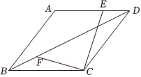
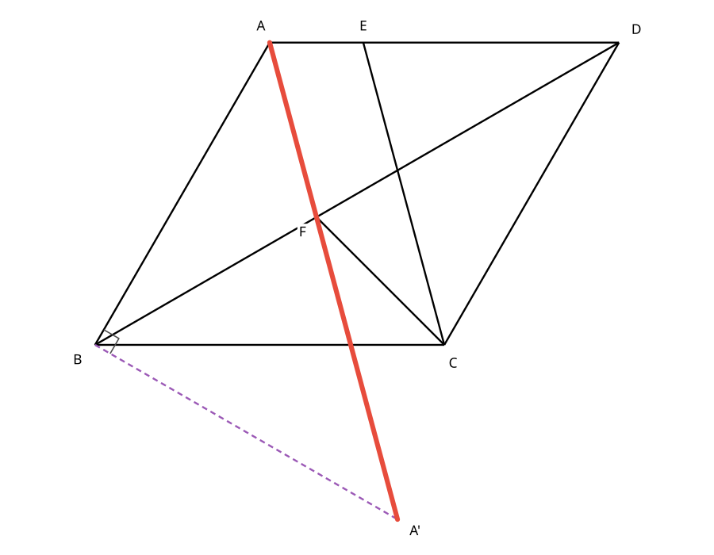

15. （2026•陕西模拟）如图，在菱形 $ABCD$ 中，$\angle ABC=60^\circ$，连接 $BD$，点 $E$，$F$ 分别是边 $AD$，对角线 $BD$ 上的动点，且 $DE=BF$，连接 $CE$，$CF$，当 $CE+CF$ 取得最小值 $5\sqrt{2}$ cm 时，$AB$ 的长为 ___ cm。

> [!question]- 点击查看答案与解析
> 【答案】$5$
>
> 【考点】菱形的轴对称性、全等三角形与最短路线、勾股定理 → [[【初中数学知识点体系-人教版】#21-2 特殊的平行四边形]]、[[【初中数学知识点体系-人教版】#15-1 图形的轴对称]]、[[【初中数学知识点体系-人教版】#14-2 三角形全等的判定]]、[[【初中数学知识点体系-人教版】#20-1 勾股定理]]
>
> 【解析】
> 菱形的对角线 $BD$ 是对称轴，$A$、$C$ 关于 $BD$ 对称，$\therefore CF=AF$，$\therefore CE+CF=CE+AF$。
> 设 $AB=a$。同第 6 题构造：在 $BD$ 下方作 $\angle A'BD=60^\circ$，$BA'=DC=a$，
> 则 $\triangle FBA'\cong\triangle EDC$（SAS，$BF=DE$，$\angle FBA'=\angle EDC=60^\circ$，$BA'=DC$），$\therefore CE=A'F$。
> $\therefore CE+CF=AF+FA'\ge AA'$，而 $\angle ABA'=\angle ABD+\angle DBA'=30^\circ+60^\circ=90^\circ$，$AB=BA'=a$，
> $\therefore AA'=\sqrt{2}a$，即最小值为 $\sqrt{2}a$。
> 由 $\sqrt{2}a=5\sqrt{2}$ 得 $a=5$，$\therefore AB=5$ cm。
> 
>
> 【易错点】本题连的是 $CE$、$CF$（都从 $C$ 出发），须先用菱形对称性把 $CF$ 换成 $AF$ 才落入标准逆等线模型；最小值 $\sqrt{2}AB$ 与边长成正比。
