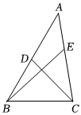
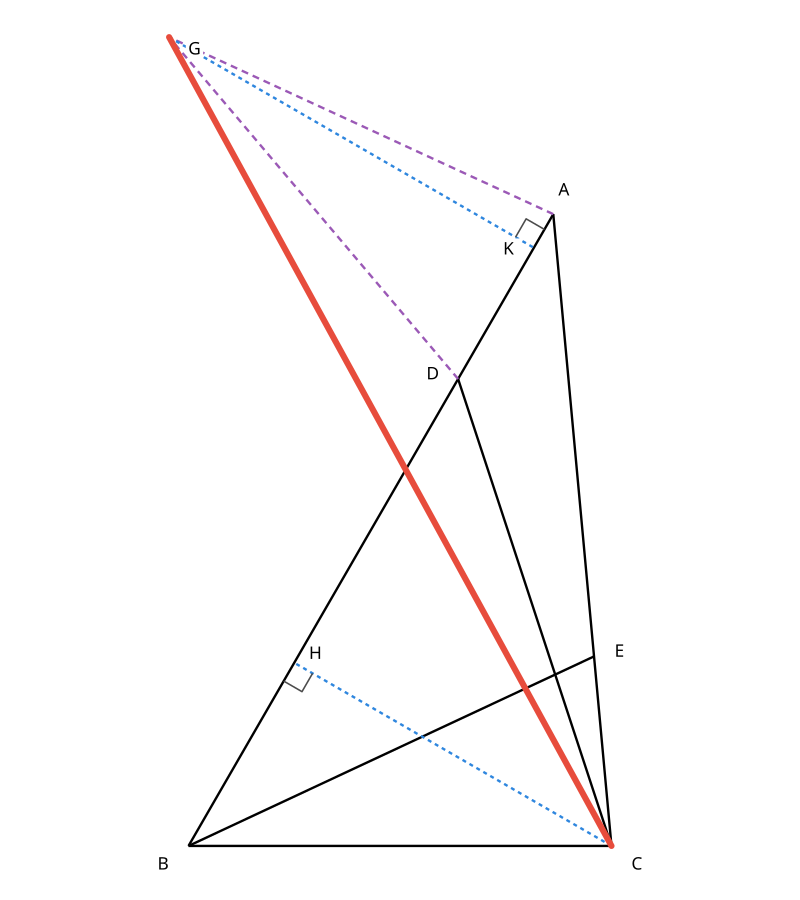

16. （2023秋•鼓楼区校级月考）如图，在 $\triangle ABC$ 中，$\angle ABC=60^\circ$，$BC=2$，$AC=3$，点 $D$，$E$ 分别是 $AB$ 与 $AC$ 上的动点，$AD=CE$，连接 $CD$，$BE$，则 $CD+BE$ 的最小值是 ___ 。

> [!question]- 点击查看答案与解析
> 【答案】$\sqrt{19}$
>
> 【考点】全等三角形的判定与性质、最短路线、勾股定理与面积法 → [[【初中数学知识点体系-人教版】#14-2 三角形全等的判定]]、[[【初中数学知识点体系-人教版】#20-1 勾股定理]]、[[【初中数学知识点体系-人教版】#13-3 三角形的内角与外角]]
>
> 【解析】
> 在 $AB$ 左上方（$C$ 的异侧）作 $\angle GAB=\angle ACB$，截取 $AG=CB=2$，连接 $DG$、$CG$。
> $\because AD=CE$，$\angle DAG=\angle ECB$，$AG=CB$，$\therefore \triangle DAG\cong\triangle ECB$（SAS），$\therefore BE=GD$。
> $\therefore CD+BE=CD+DG\ge CG$，当 $C$、$D$、$G$ 三点共线时取最小值。
> 计算 $CG$：作 $CH\perp AB$ 于 $H$。$\angle ABC=60^\circ$，$BC=2\Rightarrow BH=1$，$CH=\sqrt{3}$；
> $AH=\sqrt{AC^2-CH^2}=\sqrt{6}$，$AB=1+\sqrt{6}$。
> 作 $GK\perp AB$ 于 $K$。由 $\angle GAB=\angle ACB$ 及面积关系 $AB\cdot CH=CA\cdot CB\cdot\sin\angle ACB$，
> 得 $GK=AG\cdot\sin\angle ACB=\dfrac{AB\cdot CH}{CA}=\dfrac{(1+\sqrt{6})\sqrt{3}}{3}=\dfrac{3\sqrt{2}+\sqrt{3}}{3}$，
> $AK=\sqrt{AG^2-GK^2}=\dfrac{3-\sqrt{6}}{3}$。
> $\therefore CG^2=(AH-AK)^2+(CH+GK)^2=\dfrac{(4\sqrt{6}-3)^2+(4\sqrt{3}+3\sqrt{2})^2}{9}=19$，
> $\therefore CD+BE$ 的最小值为 $\sqrt{19}$。
> 
>
> 【易错点】$\triangle ABC$ 不是特殊三角形（$\angle ACB\approx 84.7^\circ$），构造角必须等于 $\angle ACB$；$C$、$G$ 分居 $AB$ 两侧，横向、纵向距离都要"相加"而不是相减。
