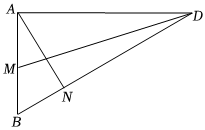
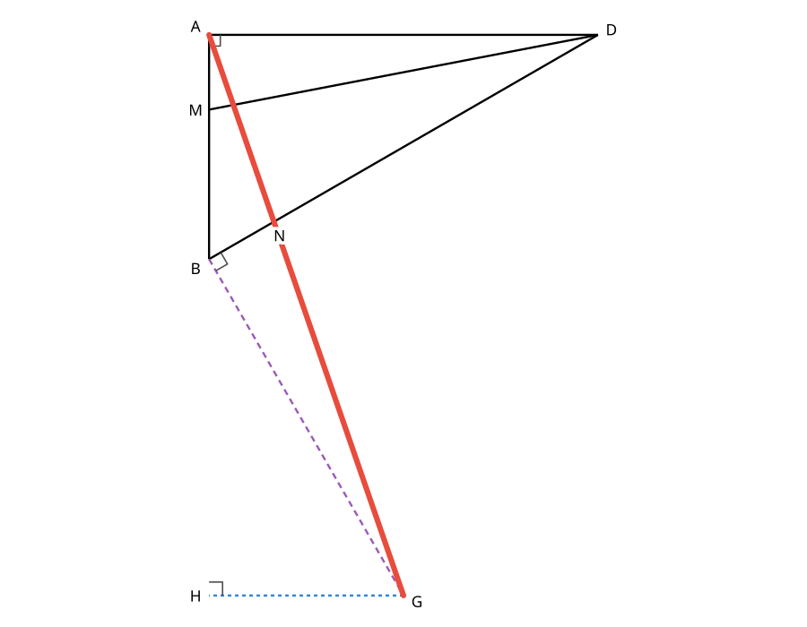

17. （2026•项城市模拟）如图，在 $\triangle ABD$ 中，$\angle BAD=90^\circ$，$AB=2$，$BD=4$，$M$、$N$ 分别为边 $AB$，边 $BD$ 上的两个动点（可与端点重合），且 $AM=BN$，则 $AN+DM$ 的最小值为 ___ ，$AN+DM$ 的最大值为 ___ 。

> [!question]- 点击查看答案与解析
> 【答案】最小值 $2\sqrt{7}$；最大值 $6$
>
> 【考点】全等三角形的判定与性质、30° 直角三角形、最短路线、勾股定理 → [[【初中数学知识点体系-人教版】#14-2 三角形全等的判定]]、[[【初中数学知识点体系-人教版】#15-3 等腰三角形]]、[[【初中数学知识点体系-人教版】#20-1 勾股定理]]
>
> 【解析】
> 在 $\mathrm{Rt}\triangle ABD$ 中，$\angle BAD=90^\circ$，$AB=2$，$BD=4$，$\therefore \angle ADB=30^\circ$，$\angle ABD=60^\circ$，$AD=\sqrt{BD^2-AB^2}=2\sqrt{3}$。
> 在 $BD$ 下方（$A$ 的异侧）作 $\angle GBD=90^\circ$，截取 $BG=DA=2\sqrt{3}$，连接 $NG$、$AG$。
> $\because BN=AM$，$\angle NBG=\angle MAD=90^\circ$，$BG=AD$，$\therefore \triangle NBG\cong\triangle MAD$（SAS），$\therefore DM=GN$。
> $\therefore AN+DM=AN+NG\ge AG$，当 $A$、$N$、$G$ 三点共线时取最小值。
> $\angle ABG=\angle ABD+\angle DBG=60^\circ+90^\circ=150^\circ$。过 $G$ 作 $GH\perp AB$ 的延长线于 $H$，则 $\angle GBH=30^\circ$，
> $\therefore GH=\dfrac12 BG=\sqrt{3}$，$BH=\sqrt{BG^2-GH^2}=3$，$AH=AB+BH=5$。
> $\therefore AG=\sqrt{AH^2+GH^2}=\sqrt{25+3}=2\sqrt{7}$，即最小值 $2\sqrt{7}$。
> 求最大值：折线 $AN+NG$ 随 $N$ 在线段上移动先减后增，最大值在端点取得。
> $M$ 与 $A$ 重合时，$AN+DM=AB+DA=2+2\sqrt{3}\approx 5.46$；
> $M$ 与 $B$ 重合时，$N$ 为 $BD$ 中点，$AN=\dfrac12 BD=2$（直角三角形斜边中线），$DM=DB=4$，和为 $6$。
> $\therefore$ 最大值为 $6$。
> 
>
> 【易错点】最大值不是"拉直"而是端点情形，须比较 $M$ 在 $A$、$B$ 两端的值；$\angle ABG=150^\circ$ 为钝角，垂足 $H$ 落在 $AB$ 的延长线上。
