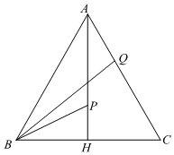
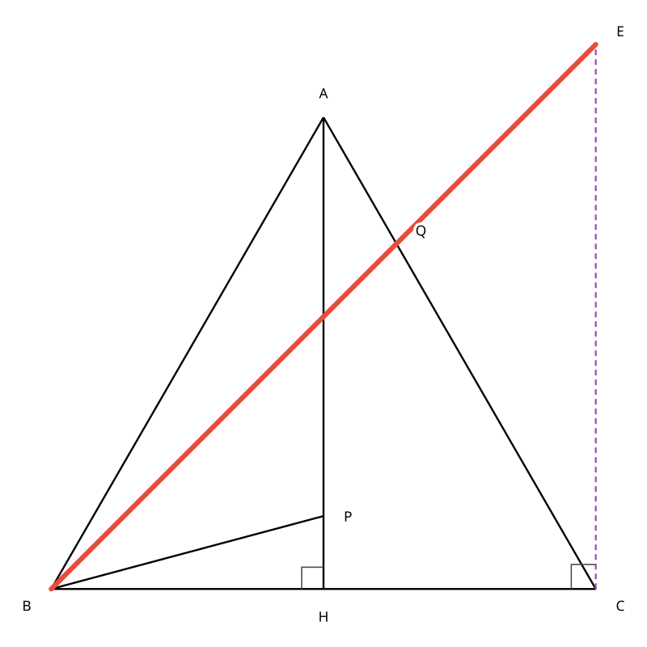

18. （2021秋•西城区校级期中）如图，$AH$ 是正三角形 $ABC$ 中 $BC$ 边上的高，在点 $A$，$C$ 处各有一只电子乌龟 $P$ 和 $Q$ 同时起步以相同的速度分别沿 $AH$，$CA$ 向前匀速爬动。确定当两只电子乌龟到 $B$ 点距离之和 $PB+QB$ 最小时，$\angle PBQ$ 的度数为 ___ 。

> [!question]- 点击查看答案与解析
> 【答案】$30^\circ$
>
> 【考点】等边三角形的性质、全等三角形的判定与性质、最短路线 → [[【初中数学知识点体系-人教版】#15-3 等腰三角形]]、[[【初中数学知识点体系-人教版】#14-2 三角形全等的判定]]、[[【初中数学知识点体系-人教版】#15-1 图形的轴对称]]
>
> 【解析】
> $AH$ 是正 $\triangle ABC$ 的高，平分 $\angle BAC$，$\therefore \angle BAH=\angle CAH=30^\circ$。
> 两龟速度相同，故 $AP=CQ$。在 $AC$ 右侧（$B$ 的异侧）作 $\angle QCE=30^\circ$，截取 $CE=AB$，连接 $QE$、$BE$。
> $\because AP=CQ$，$\angle PAB=\angle QCE=30^\circ$，$AB=CE$，$\therefore \triangle PAB\cong\triangle QCE$（SAS），$\therefore BP=QE$。
> $\therefore BP+BQ=QE+QB\ge BE$，当 $B$、$Q$、$E$ 三点共线时取最小值。
> 此时 $\angle BCE=\angle BCA+\angle ACE=90^\circ$，$CE=AB=BC$，$\triangle BCE$ 为等腰直角三角形，$\angle EBC=\angle BEC=45^\circ$。
> 由全等得 $\angle ABP=\angle CEQ=\angle CEB=45^\circ$，$\therefore \angle PBC=60^\circ-45^\circ=15^\circ$，
> $\therefore \angle PBQ=\angle QBC-\angle PBC=45^\circ-15^\circ=30^\circ$。
> 
>
> 【易错点】$P$ 在高 $AH$ 上、$Q$ 在边 $CA$ 上且 $AP=CQ$（$C$ 起量），对应角为 $\angle PAB=\angle QCE=30^\circ$；$\angle PBQ$ 用 $45^\circ-15^\circ$ 而非直接 $45^\circ$。
