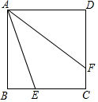
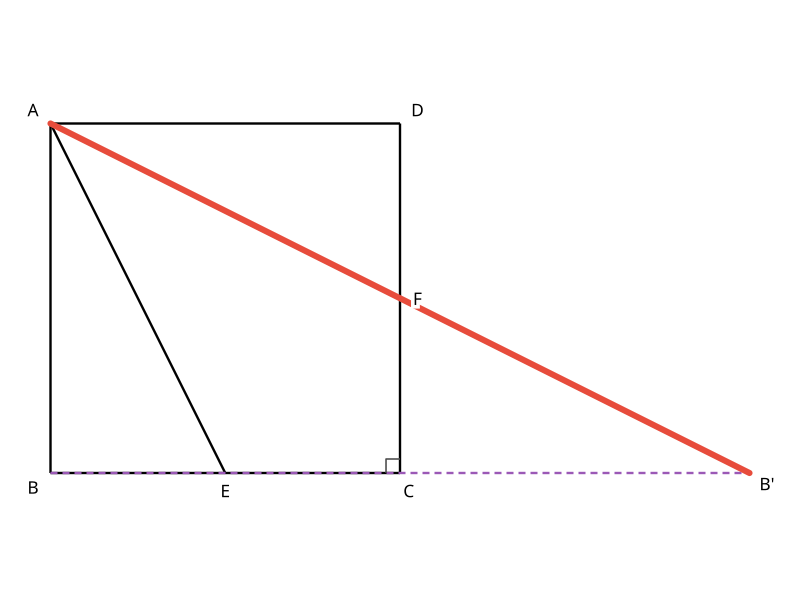

20. （2021•蓝田县一模）已知正方形 $ABCD$ 的边长为 2，$E$，$F$ 分别是边 $BC$，$CD$ 上的两个动点，且满足 $BE=CF$，连接 $AE$，$AF$，则 $AE+AF$ 的最小值为 ___ 。

> [!question]- 点击查看答案与解析
> 【答案】$2\sqrt{5}$
>
> 【考点】正方形的性质、全等三角形、轴对称（将军饮马）、勾股定理 → [[【初中数学知识点体系-人教版】#21-2 特殊的平行四边形]]、[[【初中数学知识点体系-人教版】#14-2 三角形全等的判定]]、[[【初中数学知识点体系-人教版】#15-1 图形的轴对称]]、[[【初中数学知识点体系-人教版】#20-1 勾股定理]]
>
> 【解析】
> 正方形 $ABCD$ 边长为 $2$，$AB=BC=2$，$\angle ABE=\angle BCF=90^\circ$，又 $BE=CF$，
> $\therefore \triangle ABE\cong\triangle BCF$（SAS），$\therefore AE=BF$。
> $\therefore AE+AF=BF+AF$，化为"点 $F$ 在边 $CD$ 上，求 $BF+AF$ 最小"的将军饮马问题。
> 作 $B$ 关于直线 $CD$ 的对称点 $B'$（在 $CD$ 右侧，$CB'=CB=2$），连接 $FB'$、$AB'$。
> 则 $BF=B'F$，$\therefore BF+AF=AF+FB'\ge AB'$，当 $A$、$F$、$B'$ 三点共线时取最小值。
> $B$ 到直线 $CD$ 的距离为边长 $2$，故 $BB'=4$ 且 $BB'\perp CD$（水平方向）；$A$ 与 $B$ 竖直相距 $2$。
> $\therefore AB'=\sqrt{BB'^2+AB^2}=\sqrt{16+4}=2\sqrt{5}$。
> $\therefore AE+AF$ 的最小值为 $2\sqrt{5}$。
> 
>
> 【易错点】$B$ 到直线 $CD$ 的距离是边长 $2$，对称后 $BB'=4$；$A$、$B'$ 用水平 $4$、竖直 $2$ 的直角三角形计算，勿把方向弄反。
