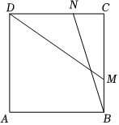
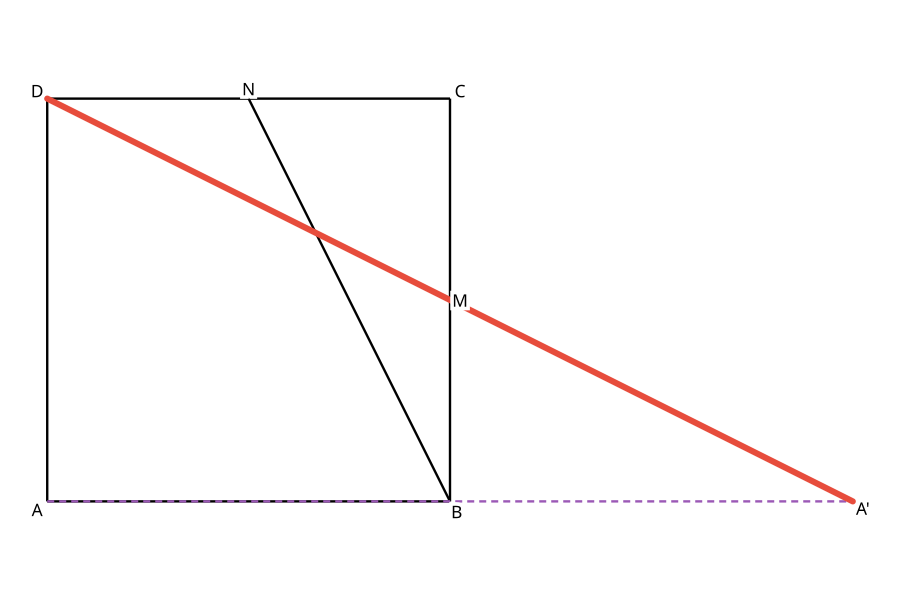

21. （2026•渭滨区一模）如图，在边长为 6 的正方形 $ABCD$ 中，$M$，$N$ 分别是边 $BC$，$DC$ 上的动点，且 $BM=CN$，连接 $BN$，$DM$，则 $BN+DM$ 的最小值为 ___ 。

> [!question]- 点击查看答案与解析
> 【答案】$6\sqrt{5}$
>
> 【考点】正方形的性质、全等三角形、轴对称（将军饮马）、勾股定理 → [[【初中数学知识点体系-人教版】#21-2 特殊的平行四边形]]、[[【初中数学知识点体系-人教版】#14-2 三角形全等的判定]]、[[【初中数学知识点体系-人教版】#15-1 图形的轴对称]]、[[【初中数学知识点体系-人教版】#20-1 勾股定理]]
>
> 【解析】
> 正方形 $ABCD$ 边长 $6$，$BM=CN$，$\angle ABM=\angle BCN=90^\circ$，$AB=BC$，
> $\therefore \triangle ABM\cong\triangle BCN$（SAS），$\therefore AM=BN$。
> $\therefore BN+DM=AM+DM$，化为"点 $M$ 在边 $BC$ 上，求 $AM+DM$ 最小"。
> 作 $A$ 关于直线 $BC$ 的对称点 $A'$（$BC$ 外侧，$BA'=BA=6$），连接 $MA'$、$DA'$。
> 则 $AM=A'M$，$\therefore AM+DM=DM+MA'\ge DA'$，当 $D$、$M$、$A'$ 三点共线时取最小值。
> $A'$ 与 $D$ 沿 $BC$ 垂直方向相距 $AB+BA'=12$，沿 $BC$ 方向相距边长 $6$，
> $\therefore DA'=\sqrt{6^2+12^2}=\sqrt{180}=6\sqrt{5}$。
> $\therefore BN+DM$ 的最小值为 $6\sqrt{5}$。
> 
>
> 【易错点】全等把 $BN$ 转移为 $AM$ 后只剩动点 $M$；对称轴是 $BC$ 所在直线，$A'$ 在正方形外侧，垂直距离为两倍边长。
