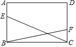
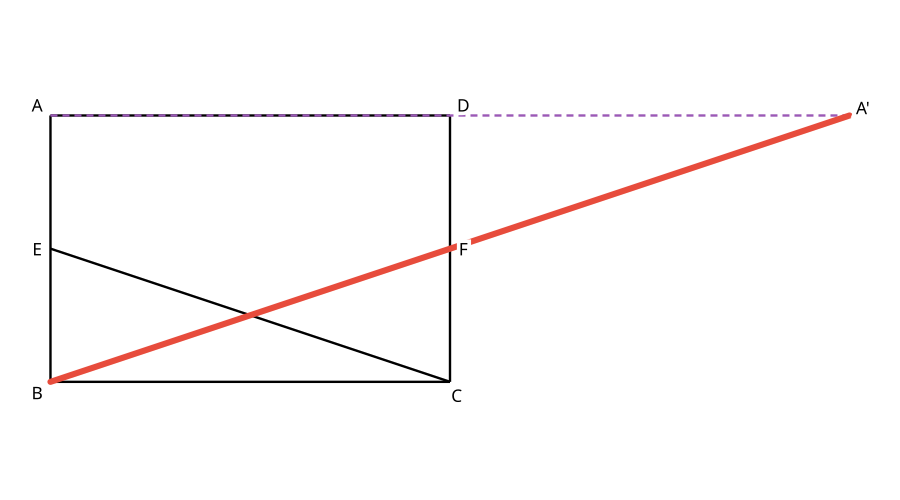

22. （2018•新城区校级三模）如图，矩形 $ABCD$ 中，$AB=2$，$AD=3$，点 $E$、$F$ 分别为边 $AB$、$CD$ 上的动点，且 $AE=CF$，则 $BF+CE$ 的最小值为 ___ 。

> [!question]- 点击查看答案与解析
> 【答案】$2\sqrt{10}$
>
> 【考点】矩形的性质、全等三角形、轴对称（将军饮马）、勾股定理 → [[【初中数学知识点体系-人教版】#21-2 特殊的平行四边形]]、[[【初中数学知识点体系-人教版】#14-2 三角形全等的判定]]、[[【初中数学知识点体系-人教版】#15-1 图形的轴对称]]、[[【初中数学知识点体系-人教版】#20-1 勾股定理]]
>
> 【解析】
> 矩形 $ABCD$ 中 $AB=2$，$AD=3$，$E$ 在 $AB$ 上、$F$ 在 $CD$ 上，$AE=CF$。
> $\because AD=CB=3$，$\angle ADF=\angle CBE=90^\circ$，$DF=CD-CF=2-AE=AB-AE=BE$，
> $\therefore \triangle ADF\cong\triangle CBE$（SAS），$\therefore AF=CE$。
> $\therefore BF+CE=BF+AF$，化为"点 $F$ 在边 $CD$ 上，求 $BF+AF$ 最小"。
> 作 $A$ 关于直线 $CD$ 的对称点 $A'$（$CD$ 外侧，$DA'=DA=3$），连接 $FA'$、$BA'$。
> 则 $AF=A'F$，$\therefore BF+AF=BF+FA'\ge BA'$，当 $B$、$F$、$A'$ 三点共线时取最小值。
> $A$ 到直线 $CD$ 的距离为 $AD=3$，故 $A'$ 与 $A$ 水平相距 $6$；$B$ 与 $A$ 竖直相距 $AB=2$。
> $\therefore BA'=\sqrt{6^2+2^2}=\sqrt{40}=2\sqrt{10}$。
> $\therefore BF+CE$ 的最小值为 $2\sqrt{10}$。
> 
>
> 【易错点】$DF=BE$ 是由 $AE=CF$ 及 $AB=CD$ 推出的，全等对应边为 $AD=CB$、$DF=BE$；$A$ 到竖直边 $CD$ 的距离是水平边长 $AD=3$，对称后水平距离加倍为 $6$。
