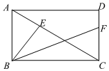
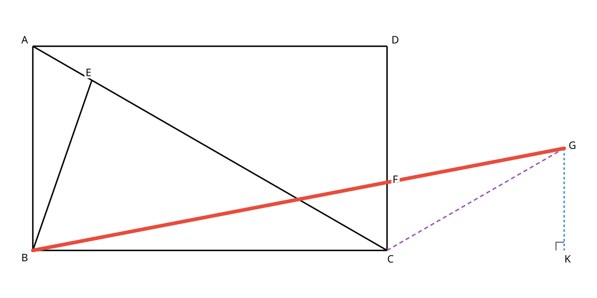

23. （2024秋•邛崃市校级期末）如图，矩形 $ABCD$ 中，$AB=3$，$AD=3\sqrt{3}$，点 $E$、$F$ 分别是对角线 $AC$ 和边 $CD$ 上的动点，且 $AE=CF$，则 $BE+BF$ 的最小值是 ___ 。

> [!question]- 点击查看答案与解析
> 【答案】$3\sqrt{7}$
>
> 【考点】矩形的性质、30° 直角三角形、全等三角形与最短路线、勾股定理 → [[【初中数学知识点体系-人教版】#21-2 特殊的平行四边形]]、[[【初中数学知识点体系-人教版】#15-3 等腰三角形]]、[[【初中数学知识点体系-人教版】#14-2 三角形全等的判定]]、[[【初中数学知识点体系-人教版】#20-1 勾股定理]]
>
> 【解析】
> 矩形中 $AB=3$，$BC=AD=3\sqrt{3}$，$\therefore AC=\sqrt{AB^2+BC^2}=\sqrt{9+27}=6$。在 $\mathrm{Rt}\triangle ABC$ 中 $AB=\dfrac12 AC$，故 $\angle ACB=30^\circ$，$\angle BAC=60^\circ$；又 $AB\parallel CD$，$\therefore \angle ACD=\angle BAC=60^\circ$（内错角）。
> $E$ 在对角线 $AC$ 上、$F$ 在边 $CD$ 上，$AE=CF$。在 $CD$ 右侧（$B$ 的异侧）作 $\angle FCG=\angle EAB=60^\circ$，截取 $CG=AB=3$，连接 $FG$、$BG$。
> $\because AE=CF$，$\angle EAB=\angle FCG=60^\circ$，$AB=CG$，$\therefore \triangle EAB\cong\triangle FCG$（SAS），$\therefore BE=GF$。
> $\therefore BE+BF=BF+FG\ge BG$，当 $B$、$F$、$G$ 三点共线时取最小值。
> 计算 $BG$：$CF$ 沿 $CD$ 竖直向上，$\angle FCG=60^\circ$ 向右侧量取，故 $CG$ 与水平方向成 $30^\circ$ 角向上。
> 过 $G$ 作 $GK\perp BC$ 的延长线于 $K$，在 $\mathrm{Rt}\triangle GCK$ 中 $\angle GCK=30^\circ$，
> $\therefore GK=\dfrac12 CG=\dfrac32$，$CK=\sqrt{CG^2-GK^2}=\dfrac{3\sqrt{3}}{2}$。
> $BK=BC+CK=3\sqrt{3}+\dfrac{3\sqrt{3}}{2}=\dfrac{9\sqrt{3}}{2}$。
> $\therefore BG=\sqrt{BK^2+GK^2}=\sqrt{\dfrac{243}{4}+\dfrac94}=\sqrt{63}=3\sqrt{7}$。
> $\therefore BE+BF$ 的最小值为 $3\sqrt{7}$。
> 
>
> 【易错点】$\angle BAC=60^\circ$（不是 $30^\circ$），$AC=6$；$F$ 在竖直边 $CD$ 上，构造角以 $CF$（竖直）为基准向右量 $60^\circ$，使 $CG$ 与水平成 $30^\circ$，再用 30° 直角三角形求 $GK$、$CK$。
